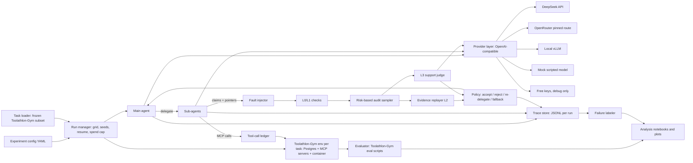

# Architecture

The plan's data flow, plus OpenRouter as another OpenAI-compatible provider.

M0–M3 runs the same boxes on an in-process fake MCP server and a scripted model. The Docker box is planned, not attached. See the README deviations.
