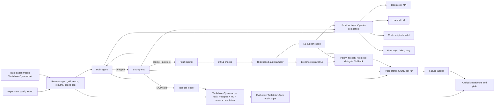

Source Page: https://cursor.com/canvas/store-ecb7e97a-5043-457c-9a0d-1e8b3fc2887e/7918710d-858d-4aa0-855a-2b698ab609cc — exported 2026-10-24

# Plan: Evidence-carrying sub-agent returns

> Low-cost plan for the paper claim: sub-agents fail silently, and replayable evidence plus risk-based spot-check audits fix most of it cheaply. Build and test the whole pipeline first (for $0 on a mock model), then run DeepSeek-V4.1-Flash-1017 for the headline (about $55 estimated), and run the local open-weight model last. Sources checked 24 Oct 2026; all costs are estimates.

> **Changes since the canvas export (24 Oct 2026, branch `feat/pilot-ready`):**
>
> - **Headline route.** DeepSeek-V4.1-Flash-1017 is called through OpenRouter (`deepseek/deepseek-v4.1-flash-1017`), pinned to DeepInfra's fp8 endpoint with no fallbacks (`openrouter_ds_1017` in `configs/models.yaml`). DeepSeek's own endpoint is blocked by the account's training-data privacy setting. Every call logs the serving provider and generation id; a call from another provider fails the run.
> - **L3 judge for pilot and headline.** The same `openrouter_ds_1017` model, billed and counted toward the cap (it was the local model). It is validated by 100 hand-labelled claims (`scripts/judge_validation.py`); at M6 the local model re-judges the same claims for a second-judge agreement check.
> - **Tasks.** DeepInfra accepted 150 tools in one request, so no task is trimmed for the 128-function limit. Seven subset70 tasks whose email setup cannot pass were swapped by a fixed rule; "needs delegation" is a fixed rule over task metadata (`docs/TASK_RULES.md`).
> - **Prompts.** `prompts/gym_v1` differs across arms only in the arm's own block; the owner freezes it after the pilot, and the headline refuses to run on an unfrozen or changed set.

## Contents

- [Budget at a glance](#budget)
- [Machine](#machine)
- [Key facts checked today](#facts)
- [Harness choice](#harness)
- [Test architecture](#arch)
- [Repo layout, config and tests](#repo)
- [Build order and milestones](#milestones)
- [Local model choice](#local)
- [1. Problem](#problem)
- [2. Method](#method)
- [3. Experiments and run matrix](#experiments)
- [4. Metrics](#metrics)
- [5. Analysis plan](#analysis)
- [Cost estimate](#cost)
- [Free keys and subscriptions](#free)
- [Timeline](#timeline)
- [Target venues](#venues)
- [Open questions for Vinayak](#questions)
- [Sources](#sources)

<a id="budget"></a>

## Budget at a glance

> **Core plan: about $55 of DeepSeek API spend (estimated range $30 to $110), plus GPU time and electricity.** (Since 24 Oct: DeepSeek-V4.1-Flash-1017 via OpenRouter on DeepInfra fp8, whose rates are lower, about $35 for the headline at the assumptions below, plus a small billed L3 judge.)
>
> Everything is built and tested on a scripted mock model first, at no cost. DeepSeek then runs only the 4-arm headline comparison on a frozen 70-task subset with 2 seeds, in weekend batches. The local model runs last and does about 4,000 runs (ablations, audit-rate sweep, fault injection). A frontier model is an optional add-on (about $320 with Claude Sonnet 5) only if reviewers ask.

<a id="machine"></a>

## Machine

| Component | Value | What it means for the plan |
| --- | --- | --- |
| CPU | AMD Threadripper PRO 9965WX, 24 cores / 48 threads | Enough to run 8 or more isolated Toolathlon-Gym task environments in parallel next to the model server. |
| RAM | 251 GiB | Resolves the RAM question: the primary model's 95 GB n-gram table fits in host RAM, so no quantized-table workaround is needed. |
| GPU | RTX PRO 6000 Blackwell, 96 GB; driver 595.91.07, CUDA 13.2 | Primary model needs about 88.8 GiB at serve time, so the GPU must be otherwise empty. |
| Disk | 8 TB NVMe, 2.1 TB free | Resolves the disk question: about 186 GB checkpoint plus run logs fit easily. |
| OS | Ubuntu 24.04.5, kernel 7.0 | Ubuntu sets kernel.yama.ptrace_scope=1 by default; the model card reports this can hang the n-gram offload startup on bare metal, so start the container with --cap-add=SYS_PTRACE. |
| Running now | A lerobot process in ~/isaac-env (PID 2046889) holding about 15 GiB VRAM | Must be stopped before serving the primary model (milestone M6). It does not block M0 to M5, which use no local GPU. |

<a id="facts"></a>

## Key facts checked today

| Item | What I found | Consequence |
| --- | --- | --- |
| DeepSeek 'V4.1 1017' | DeepSeek-V4.1-Flash-1017, called as model "deepseek-flash" on DeepSeek's API; legacy "deepseek-v4-flash" routes to it. On OpenRouter: `deepseek/deepseek-v4.1-flash-1017`, served as `deepseek/deepseek-v4.1-flash-20261017`. | Log the served model string on every call; the alias can move. The pilot and headline use the OpenRouter route pinned to `deepinfra/fp8` (changed 24 Oct). |
| DeepSeek pricing | $0.15 input (cache miss) / $0.003 cache hit / $0.60 output per M tokens off-peak; double at peak (01:00 to 04:00 and 06:00 to 10:00 UTC on weekdays). DeepInfra fp8 via OpenRouter: $0.098 / $0.00294 / $0.294, no peak pricing. | Direct API: run on weekends. The OpenRouter route has no peak windows. |
| MS-Eval code | github.com/LINs-lab/MS-Eval returned 404 on 24 Oct 2026. | Rebuild the setup from the paper's appendix. |
| Toolathlon-Gym | Apache-2.0. 503 tasks, 25 MCP servers, local PostgreSQL. Its run_parallel.sh gives each task its own PostgreSQL, agent container and Docker network, so parallel tasks share no state. Supports MODEL_PLATFORM=openai_compatible. | Use it as the environment layer, including its isolation scheme and evaluation scripts. |
| Toolathlon (original) | Its agent scaffold is built on the OpenAI Agents SDK and has a decoupled mode where the agent loop runs on the host with a selectable framework. GitHub detects no license file in that repo. | Same SDK as the recommended base. Read it for reference; do not copy its code without a license. |

<a id="harness"></a>

## Harness choice

*License, stars and last push from the GitHub API on 24 Oct 2026. 'Not checked' means I did not verify that feature today.*

> **Recommendation: a thin own harness in Python on the OpenAI Agents SDK, with Toolathlon-Gym as the environment.** _(info)_
>
> The SDK already does sub-agents (agent.as_tool), structured outputs, MCP clients, OpenAI-compatible endpoints and tracing. Its as_tool has a custom_output_extractor hook, which is exactly where the audit step goes: the sub-agent's structured return is checked, audited and accepted or rejected before the main agent sees it. Everything specific to this paper (ledger, checks, sampler, policy, injector, cost accounting) stays in your own small Python package. Kimi Code CLI and DeepSeek Harness both have stronger built-in sub-agents, but changing what a sub-agent returns means forking a large, fast-moving TypeScript codebase.

| Option | License, activity | Built-in sub-agents | Changing the return format and adding an audit step | OpenAI-compatible (DeepSeek API, local vLLM) | Toolathlon-Gym / MS-Eval fit | Verdict |
| --- | --- | --- | --- | --- | --- | --- |
| OpenAI Agents SDK (openai/openai-agents-python) inside a thin own harness | MIT, Python, about 30k stars, pushed 22 Oct | Handoffs and agent.as_tool (agents as tools) | Easy: sub-agent output_type can be a Pydantic model (the claim schema); as_tool(custom_output_extractor=...) runs your validation and audit code on the result; everything in Python | Yes: set_default_openai_client or OpenAIChatCompletionsModel with any base_url | Toolathlon's own scaffold uses this SDK; MCP stdio and streamable-HTTP clients built in | Base |
| Kimi Code CLI (MoonshotAI/kimi-code) | MIT, TypeScript monorepo, about 8k stars, pushed 23 Oct | Yes: coder, explore, plan, custom agents as Markdown files, AgentSwarm | Hard: hooks SubagentStop and PostToolUse are observation-only; PreToolUse and Stop can block but not rewrite a return. A real audit step means forking the TypeScript agent core | Yes: provider type openai with base_url; handles DeepSeek reasoning_content | MS-Eval was built on it, so it is closest in spirit, but MS-Eval's code is not public | Not the base; optional sanity check via its non-interactive print mode |
| DeepSeek Harness (deepseek-ai/deepseek-harness) | MIT, TypeScript, created 13 Aug 2026, developer preview with announced breaking changes; about 260k stars, pushed 23 Oct | Yes: in-process spawn and fork children, plus ACP, Codex, Claude Code and SDK backends | Medium: sub-agent requests support an outputSchema that returns a structured result, and everything is a plugin, so an audit plugin is possible; but APIs are changing and the repo has about 21,900 files | Native DeepSeek adapter; pi-ai adapter for OpenAI-compatible gateways and self-hosted servers | No direct link to Toolathlon or MS-Eval | Not the base now; good candidate for a later 'works in a real harness' port of the protocol |
| Inspect AI (UKGovernmentBEIS/inspect_ai) | MIT, Python, about 3k stars, pushed 24 Oct | as_tool and handoff() around react() agents | Easy: handoff(output_filter=...) can run custom code on what a sub-agent hands back | Yes, including a vLLM provider | Strong eval logging, but Toolathlon-Gym's containers would need wiring in | Runner-up base |
| OpenCode (anomalyco/opencode) | MIT, TypeScript, about 221k stars, pushed 24 Oct | Not checked | TypeScript fork needed | Not checked | None | Not chosen |
| OpenHands (OpenHands/OpenHands) | MIT, TypeScript, about 92k stars, pushed 24 Oct | Not checked | Large platform with its own runtime; heavy to modify | Not checked | None | Not chosen |
| Codex CLI (openai/codex) | Apache-2.0, Rust, about 131k stars, pushed 23 Oct | Yes (used in the concurrency study) | Rust fork needed | Not checked | None | Not chosen |
| Claude Agent SDK (anthropics/claude-agent-sdk-python) | MIT, Python, about 8k stars, pushed 24 Oct | Not checked | Not checked | Built for Claude models; OpenAI-compatible use not checked | None | Not chosen |
| smolagents, LangGraph | Apache-2.0 / MIT, Python, about 30k / 44k stars, both active | Not checked in detail | Possible, but you would build the sub-agent pattern yourself | Not checked | None | Not chosen |
| Toolathlon-Gym example agent (CAMEL) | Apache-2.0 (Toolathlon-Gym and CAMEL) | Single agent | - | openai_compatible platform | Native | Use for the environment and evaluation, not as the agent harness |

| Helper | Role in this project |
| --- | --- |
| Toolathlon-Gym (eigent-ai/toolathlon_gym) | Task containers, per-task isolated PostgreSQL and network (run_parallel.sh pattern), preprocess and evaluation scripts. |
| MCP Python SDK (modelcontextprotocol/python-sdk, MIT) | Direct MCP client for the evidence replayer (re-issuing read-only calls), and a tiny fake MCP server for tests. |
| Pydantic | Claim schema in code, exported as JSON Schema; validation of every sub-agent return. |
| Agents SDK tracing | A custom trace processor writes spans (LLM calls, tool calls, sub-agent runs) into the per-run JSONL trace; the SDK's default upload is turned off. |
| OpenTelemetry or self-hosted Langfuse (optional) | Only if you want a trace UI later; JSONL stays the source of truth. Check Langfuse's licence for any enterprise-only parts before relying on them. |
| vLLM (Docker image) and its benchmark CLI | Serving the local model in M6 and a throughput smoke test before the long runs. |
| pytest, pandas, matplotlib, statsmodels | Tests, analysis, plots, McNemar and mixed-effects models. |

<a id="arch"></a>

## Test architecture

Diagram nodes:

- **Config + task loader** — frozen subset, seeds
- **Run manager** — grid, resume, spend cap
- **Toolathlon-Gym env** — per-task Postgres + MCP
- **Main agent**
- **Sub-agents** — structured returns
- **Tool-call ledger**
- **Fault injector**
- **L0/L1 checks**
- **Audit sampler** _(decision)_
- **Replayer L2 + judge L3**
- **Policy** — accept / reject / re-delegate _(decision)_
- **Provider layer** — DeepSeek, vLLM, mock
- **Trace store** — JSONL per run
- **Evaluator + labeler**
- **Analysis** _(terminal)_

Edges:

- Config + task loader → Run manager
- Run manager → Toolathlon-Gym env
- Run manager → Main agent
- Main agent → Sub-agents (delegate)
- Sub-agents → Tool-call ledger (MCP calls)
- Tool-call ledger → Toolathlon-Gym env
- Sub-agents → Fault injector (claims)
- Fault injector → L0/L1 checks
- L0/L1 checks → Audit sampler
- Audit sampler → Replayer L2 + judge L3
- Replayer L2 + judge L3 → Policy
- Policy → Main agent (accepted claims)
- Main agent → Provider layer _(dashed)_
- Main agent → Trace store _(dashed)_
- Toolathlon-Gym env → Evaluator + labeler
- Trace store → Evaluator + labeler
- Evaluator + labeler → Analysis

Mermaid source of the same diagram (paste into the repo's docs/architecture.md):



| Component | What it does | Key design choices |
| --- | --- | --- |
| Task loader | Reads tasks/subset70.txt (and the 160-task pool), checks the file's sha256, maps each name to its Toolathlon-Gym task directory. | The subset is chosen once in M2, before any paid run, stratified by domain and number of MCP servers. |
| Environment manager | For each run, brings up an isolated Toolathlon-Gym environment (own PostgreSQL, task container, Docker network), runs the task's preprocess script, tears it down afterwards. | Copies the run_parallel.sh isolation pattern so 8 or more tasks can run at once without shared state. |
| Harness (main agent and sub-agents) | Agents SDK agents: the main agent gets the task, its tools and one tool per sub-agent type (MS-Eval's Spec profiles); sub-agents get role-specific MCP tool allowlists. SA arm = main agent with all tools and no sub-agents. | Prompts from MS-Eval appendix E, frozen under prompts/v1/. Parallel delegation: check in M1 whether the SDK runs multiple tool calls concurrently; if not, add a batch tool that runs sub-agents with asyncio.gather (AgentSwarm-style). |
| Tool-call ledger | Wraps every MCP call: assigns a call ID, stores arguments, full result, sha256 and whether the tool is read-only or writes. | Written by the harness, never by the model, so pointers can be checked against it. |
| Claim and evidence schema | Sub-agent output_type is a Pydantic model exported as the JSON Schema below; invalid JSON gets one repair request, then counts as a failed return. | DeepSeek's API supports JSON output mode; enforce the schema in code rather than relying on provider-side JSON Schema support. |
| Fault injector | Between the sub-agent and the checks: with a seeded probability, corrupts one claim (numeric perturbation, fabricated entity, omission, false action_done, mismatched pointer), in naive or pointer-consistent form. | Off by default; identical corruption decisions across arms for the same (task, seed, return index). |
| L0/L1 checks | Pointer exists in the ledger, file or table; quoted span or value appears in the logged result. | Deterministic, run on every claim, no tokens. |
| Risk-based audit sampler | Scores claims (used by a later write or the deliverable, derived or action_done, numeric, sub-agent hit limits or had errors, low confidence, failed L0/L1) and picks the top ones up to budget r; random sampler as control. | Seeded, budget-exact, unit-tested. |
| Evidence replayer (L2) and judge (L3) | L2 re-issues read-only MCP calls through the MCP Python SDK and compares; for writes it reads back state. L3 asks the judge model whether the evidence supports the claim. | Changed 24 Oct: in the pilot and headline the judge is the agent model on the same pinned route (billed, counted toward the cap), the same for all arms; it sees only the claim and its cited calls. Validated against 100 hand labels; the local model re-judges those claims at M6. |
| Reject / re-delegate policy | Accept, or reject and re-delegate once with the failed claim and check named, then fall back to the main agent doing the sub-task. | Every decision is a trace event. |
| Provider layer | One OpenAI-compatible client per model entry in configs/models.yaml (base_url, model, key variable, price table). Records the served model string, token usage including cache-hit counts, latency and HTTP retries for every call. | Swapping DeepSeek, free debug keys, local vLLM or the mock is a config change. Confirm DeepSeek's usage field names for cache hits in M4. |
| Mock scripted model | Implements the Agents SDK's Model interface and replays scripted responses (tool calls, sub-agent returns, malformed JSON) from fixture files. | Lets the whole pipeline, including the real Toolathlon-Gym tools, run for $0 in tests. |
| Run manager | Expands an experiment YAML into (task, arm, model, seed) runs; skips finished runs on restart; enforces the spend cap from logged usage; for DeepSeek, only starts runs in off-peak windows. | Fixed system prompt and tool list placed first in every request so repeated prefixes bill at the cache-hit price. |
| Trace store | One JSONL file per run: run_start (config hash, git commit, served model), llm_call, tool_call, subagent_return, injection, check, audit, policy, run_end (eval result, tokens, cost). | JSONL is the source of truth; a parquet index is rebuilt from it for analysis. |
| Evaluator and failure labeler | Runs the task's Toolathlon-Gym evaluation script; computes SA-versus-arm flips; a judge prompt labels failure causes with MS-Eval's taxonomy; 50 labels are checked by hand. | Labels are stored next to traces, never overwrite them. |
| Analysis notebooks | Sanity checks, headline table, fault-injection catch rates, reliability-per-dollar curve, statistics. | Built and tested on mock and pilot data before the real runs. |

Claim and evidence JSON Schema for sub-agent returns:

```json
{
  "$schema": "https://json-schema.org/draft/2020-12/schema",
  "title": "SubagentReturn",
  "type": "object",
  "required": ["subagent_id", "status", "claims", "open_issues"],
  "properties": {
    "subagent_id": {"type": "string"},
    "status": {"enum": ["complete", "partial", "failed"]},
    "claims": {
      "type": "array",
      "items": {
        "type": "object",
        "required": ["claim_id", "text", "kind", "evidence"],
        "properties": {
          "claim_id": {"type": "string"},
          "text": {"type": "string"},
          "kind": {"enum": ["fact", "derived", "action_done", "artifact"]},
          "value": {},
          "evidence": {
            "type": "array",
            "items": {
              "oneOf": [
                {"type": "object", "required": ["type", "call_id"],
                 "properties": {"type": {"const": "tool_call"}, "call_id": {"type": "string"}, "span": {"type": "string"}}},
                {"type": "object", "required": ["type", "path", "sha256"],
                 "properties": {"type": {"const": "file"}, "path": {"type": "string"}, "lines": {"type": "string"}, "sha256": {"type": "string"}}},
                {"type": "object", "required": ["type", "query"],
                 "properties": {"type": {"const": "search"}, "query": {"type": "string"}, "rank": {"type": "integer"}, "doc_id": {"type": "string"}}},
                {"type": "object", "required": ["type", "sql"],
                 "properties": {"type": {"const": "db"}, "sql": {"type": "string"}, "row_keys": {"type": "array"}}}
              ]
            }
          },
          "depends_on": {"type": "array", "items": {"type": "string"}},
          "confidence": {"enum": ["low", "medium", "high"]}
        }
      }
    },
    "open_issues": {"type": "array", "items": {"type": "string"}}
  }
}
```

<a id="repo"></a>

## Repo layout, config and tests

| Path | Contents |
| --- | --- |
| pyproject.toml, Makefile, README.md | Python 3.12 project (uv), make test / make pilot / make headline / make local targets. |
| configs/models.yaml, configs/experiments/*.yaml, configs/prices/*.yaml | Model endpoints, experiment grids, dated price tables. |
| tasks/pool160.txt, tasks/subset70.txt, tasks/SHA256SUMS | Task lists and their hashes. |
| prompts/v1/ | Frozen main-agent, sub-agent, self-verify, repair and judge prompts. |
| src/evcarry/env/ | toolathlon.py (task loader, preprocess and eval wrappers), isolation.py (per-task Docker project). |
| src/evcarry/providers/ | registry.py, openai_compat.py, scripted.py (mock Model), usage.py (tokens, cache hits, cost). |
| src/evcarry/harness/ | agents.py (main and Spec sub-agents), delegate.py (as_tool wrappers with the audit extractor), arms.py (SA, vanilla, self-verify, typed, evidence variants). |
| src/evcarry/ledger/ | ledger.py (MCP call wrapper), store.py. |
| src/evcarry/protocol/ | schema.py, checks.py (L0, L1), replayer.py (L2), judge.py (L3), sampler.py, policy.py. |
| src/evcarry/inject/ | corruptions.py, injector.py. |
| src/evcarry/runs/ | manager.py (grid, resume), budget.py (spend cap, off-peak windows), cli.py. |
| src/evcarry/trace/ | writer.py (JSONL), processor.py (Agents SDK trace processor), index.py (parquet). |
| src/evcarry/eval/ | evaluate.py, flips.py, label_failures.py, metrics.py. |
| analysis/ | 01_sanity.ipynb, 02_headline.ipynb, 03_fault_injection.ipynb, 04_reliability_per_dollar.ipynb. |
| serving/ | serve_primary.sh, serve_fallback.sh, smoke_test.py, gpu_check.sh. |
| tests/unit, tests/integration, tests/fixtures | Fixtures: scripted model responses, ledger snapshots, a fake MCP server. |

Config format (YAML, two files shown):

```yaml
# configs/experiments/headline_deepseek.yaml
experiment: headline_deepseek_v1
tasks: tasks/subset70.txt          # sha256 checked at start
arms: [sa, vanilla_mad, self_verify, evidence_risk]
seeds: [1, 2]
model: openrouter_ds_1017          # key in configs/models.yaml (changed 24 Oct; was deepseek_flash)
audit: {sampler: risk, rate: 0.3, checks: [L0, L1, L2, L3]}
judge_model: openrouter_ds_1017    # billed, counted toward the cap (changed 24 Oct; was local_primary)
limits: {max_steps: 100, max_seconds: 7200, context: 131072}
prompts: prompts/gym_v1/           # frozen after the pilot, byte-identical system prompt first
require_frozen_prompts: true
budget: {cap_usd: 80, schedule: offpeak_only}
parallel_tasks: 8
out: runs/headline_deepseek_v1/

# configs/models.yaml
openrouter_ds_1017: {kind: openrouter, base_url: https://openrouter.ai/api/v1, model: deepseek/deepseek-v4.1-flash-1017, api_key_env: OPENROUTER_API_KEY, routing: {order: [deepinfra/fp8], allow_fallbacks: false}, prices: prices/openrouter_deepseek_1017_2026-10-24.yaml}
deepseek_flash: {base_url: https://api.deepseek.com, model: deepseek-flash, api_key_env: DEEPSEEK_API_KEY, prices: prices/deepseek_2026-10-24.yaml}
local_primary: {base_url: http://127.0.0.1:8000/v1, model: primitive-ai/Qwen3.8-Flash-Next-NVFP4, api_key_env: NONE}
mock: {provider: scripted, script_dir: tests/fixtures/scripts/}
```

| Test | Kind | What it proves |
| --- | --- | --- |
| Schema round-trip and rejection of malformed returns | Unit | Pydantic model and exported JSON Schema agree; bad returns trigger exactly one repair. |
| L0/L1 against ledger fixtures | Unit | Missing call IDs, wrong spans and hash mismatches are caught; valid claims pass. |
| Replayer against the fake MCP server | Unit | Read-only calls are re-issued and compared; write claims use read-back; no write is ever replayed. |
| Sampler determinism and budget | Unit | Same seed gives same picks; number of audited claims equals the budget; risk ordering is as specified. |
| Policy state machine | Unit | Accept, reject, one re-delegation, fallback; no infinite loops. |
| Each corruption type | Unit | Injector produces the intended change, naive and pointer-consistent, reproducibly per seed. |
| Cost accounting | Unit | Cache hit / miss / output tokens times the dated price table, peak and off-peak, match hand-computed values. |
| Spend cap and off-peak window | Unit | Runner refuses to start a paid run above the cap or inside peak hours. |
| Resume | Integration | Killing the runner mid-grid and restarting skips finished runs and produces identical results. |
| SA and vanilla MAD on mock | Integration | Scripted run through the real harness and fake MCP server produces a complete JSONL trace. |
| Corrupted return is rejected end to end | Integration | Mock sub-agent returns a fabricated claim; checks reject it; re-delegation happens; trace shows each step. |
| One real Toolathlon-Gym task with mock model | Integration | Environment comes up isolated, scripted tool calls hit real MCP servers, the task's evaluation script runs. |
| Provider contract (skipped by default) | Integration, opt-in | With an env flag, one tiny call to DeepSeek or local vLLM confirms usage fields and served model string are logged. |

<a id="milestones"></a>

## Build order and milestones

*Times are rough, at hobby pace (evenings and weekends).*

| Milestone | Work | Done when | Rough time | Cost |
| --- | --- | --- | --- | --- |
| M0 Environment and repo | Create the repo and layout; Python env with the Agents SDK, MCP SDK, Pydantic, pytest. Install Docker and the NVIDIA Container Toolkit if missing. Build Toolathlon-Gym and run its example agent on 3 tasks with a free key. Start downloading the primary model checkpoint in the background (no GPU needed). | make test runs (empty suite passes); 3 Toolathlon-Gym tasks graded; 3 tasks run in parallel with isolated environments. | 2 to 3 evenings | $0 |
| M1 Harness on mock provider | Provider layer, scripted mock Model, ledger, SA and vanilla MAD arms, JSONL traces, run manager with resume. Debug against real models with free keys only. | SA and vanilla MAD run end to end on mock and on 3 real Toolathlon-Gym tasks with scripted tool calls; traces complete; resume test passes. | About 1 week | $0 |
| M2 Schema, replayer and audit on mock | Claim schema, L0 to L3, sampler, policy, self-verify and typed-contract arms. Freeze the 70-task subset and the 160-task pool. | All unit tests above pass; corrupted-return integration test passes; subset70.txt committed with hash. | About 1 week | $0 |
| M3 Fault injector | Five corruption types, two variants, seeded; analysis notebooks drafted on mock traces. | Injector unit tests pass; mock fault-injection run produces catch-rate numbers in 03_fault_injection.ipynb. | 3 to 4 evenings | $0 |
| M4 DeepSeek pilot | 40 runs: 10 tasks from the frozen subset, 4 arms, 1 seed. DeepSeek-V4.1-Flash-1017 via OpenRouter (DeepInfra fp8), also the L3 judge. Fixed prompts for cache hits; hand-label the judge sample, then freeze the prompts. | Under 5% harness errors; measured $ per run and cache-hit rate recorded; cost table and cap updated. | 1 weekend | About $4 |
| M5 DeepSeek headline | 560 runs: 70 tasks, 4 arms, 2 seeds, same route and judge as M4, frozen prompts. | All runs finished or explained; headline table and flip rates computed; spend under the cap. | 2 weekends | About $50 |
| M6 Local model, last | Confirm with Vinayak, then stop the lerobot process (PID 2046889) and check nvidia-smi shows the GPU empty. Pull the vllm/vllm-openai:qwen38-flash-next image, serve the primary model, run the smoke test (20 tool-calling tasks at 128K context), measure throughput. Then core grid, audit-rate sweep, fault injection, and L3 judging and failure labeling for all runs; re-judge the 100-claim judge-validation sample with the local model (second-judge agreement with the headline judge). | Smoke test passes within 3 days (else switch to Qwen3.8-27B FP8); all local runs finished; labels done. | About 2 weeks (5 to 10 GPU days) | $0 API; electricity |

<a id="local"></a>

## Local model choice

*Toolathlon-Verified is the 108-task public tool-use leaderboard; vendor numbers are self-reported. 'Community' numbers come from one tester's single RTX PRO 6000 (8K input / 512 output, concurrency 32, no prefix cache).*

| Model | Size | Fit on one 96 GB card | Toolathlon-Verified | Other scores | Context | Measured speed (one RTX PRO 6000) | Decision |
| --- | --- | --- | --- | --- | --- | --- | --- |
| Qwen3.8-Flash-Next, NVFP4 (primitive-ai build) | 125B MoE, 6B active, plus 51B n-gram table and 4B MTP | 88.8 GiB VRAM; n-gram table in host RAM (about 100 GB, fine with 251 GiB). Needs the vllm/vllm-openai:qwen38-flash-next image; single-GPU offload is still an open vLLM PR (#53899). | 73.5 (vendor; same table: DeepSeek-V4-Flash-0731 70.3) | SWE-bench Pro 62.5, CoWorkBench 73.9 (vendor); community tool-calling suite 84.6% correct calls | 262K native; card tested at 32K / 36 sequences, a field report at 135,168 / 64 | 74.4 tok/s single, 142.6 with MTP; 484 tok/s at concurrency 32 | Primary |
| Qwen3.8-27B, official FP8 | 27B dense hybrid | 38 GB weights; mainline vLLM recipe | 67.1 (vendor) | SWE-bench Pro 61.7, Terminal Bench 2.1 73.0 (vendor); community 85.5% correct calls | 262K native, 1M with YaRN | 908 tok/s at concurrency 32 (community) | Fallback |
| Qwen3.6-35B-A3B FP8 | 36B MoE, 3B active | About 35 to 38 GB | 26.9 (llm-stats listing) | MCP-Atlas 62.8 (vendor) | 262K | - | Dropped |
| gpt-oss-120b / GLM-4.7-Flash / Laguna-S-2.1 | 117B / 31B / 110B MoE | Fit | no official score / not found / 49.7 | - | - | - | Not chosen |
| GLM-5.3-Flash, DeepSeek-V4.1-Flash | 320B / 284B MoE | Published RTX PRO 6000 recipes use 4 GPUs | 78.4 / estimate only | - | - | - | Out of reach |

- **Primary serve command:** docker run --gpus all --ipc=host --cap-add=SYS_PTRACE -p 8000:8000 -e VLLM_PLE_CPU_OFFLOAD=1 -e VLLM_PLE_OFFLOAD_READY_TIMEOUT=1800 vllm/vllm-openai:qwen38-flash-next --model primitive-ai/Qwen3.8-Flash-Next-NVFP4 --distributed-executor-backend mp --gpu-memory-utilization 0.92 --max-model-len 32768 --max-num-seqs 36 --enable-auto-tool-choice --tool-call-parser qwen3_coder --reasoning-parser qwen3 --speculative-config '{"method":"mtp","num_speculative_tokens":3}'. Then try --max-model-len 131072 with --max-num-seqs 32 to 64. Mount the card's connector_mrv2.py fix for a known startup race.
- **Fallback serve command:** vllm serve Qwen/Qwen3.8-27B-FP8 --max-model-len 131072 --kv-cache-dtype fp8 --enable-prefix-caching --language-model-only --reasoning-parser qwen3 --enable-auto-tool-choice --tool-call-parser qwen3_coder --speculative-config '{"method":"mtp","num_speculative_tokens":3}' (vLLM 0.17.0 or later, transformers 5.8.0 or later).
- **Blackwell notes:** sm120 runs NVFP4 natively via FlashInfer CUTLASS kernels (auto-selected on the Flash-Next image). Marlin MoE backend does not combine with MTP on that image. Avoid vLLM strict mode on no-argument tools (open issue: Qwen 3.x loops). Check the image's CUDA version against driver 595.91.07 in the M6 smoke test.

<a id="problem"></a>

## 1. Problem: sub-agents fail silently

MS-Eval (Oct 2026) pairs each sub-agent run with a single-agent run on the same task. Across eight models it finds 124 success-to-failure cases, and Delegated Failure Propagation (failed, corrupted or unverified sub-agent output flowing downstream) accounts for over half of them: 33 of 45 for GPT-5.6-Sol, 14 of 22 for Claude-Sonnet-5. Related: in 'Same Context, Different Agents' an LLM verifier approved 87% of the investigator group's wrong answers, and parallel sub-agents cost Claude Code about 24 points on SWE-bench Verified in the concurrency study.

- **Paper claim:** Sub-agent errors are mostly silent. Replayable evidence on every claim plus a small, risk-weighted audit removes most delegated failure propagation at low extra cost.
- **What would falsify it:** No reduction in success-to-failure flips versus vanilla delegation, or only at a cost close to the single agent, or no better than free-text self-verification.

<a id="method"></a>

## 2. Method

| Check level | What it does | Cost |
| --- | --- | --- |
| L0 existence | Every pointer resolves to a real ledger entry, file or row. | Free |
| L1 content match | Quoted span or value appears in the logged result. | Free |
| L2 replay | Re-run read-only call or re-read file or row; read back state for writes. | One tool call |
| L3 support | Judge model: does the evidence support the claim? Pilot and headline: the agent model on the pinned OpenRouter route; M6: the local model. | A few API cents per run (headline); local GPU time (M6) |

- **Default policy:** L0 and L1 on every claim; L2 and L3 on sampled claims.
- **Sampling:** temperature 0 on every agent and judge call, every arm and provider; sent explicitly and logged per call.
- **Audit budget:** per sub-agent return, `max(1, round_half_up(r × claims))` claims, capped at the number of claims: every return with a claim gets at least one L2/L3 audit when r > 0 (fixed 2026-10-24, before the pilot). The risk and random arms use the same budget.
- **Risk-based sampler:** Features: used by a later write or the deliverable; derived or action_done; numeric; sub-agent hit limits, had errors or finished very fast; low confidence; failed L0/L1. Random sampler at equal budget is the control.
- **On failure:** Reject, re-delegate once naming the failed claim, then the main agent does the sub-task.
- **Sub-agent sessions:** in every delegating arm each sub-agent keeps one conversation per run; every call (main agent or harness re-delegation) continues it, so retries carry the same context in every arm (fixed 2026-10-24, before the pilot).

<a id="experiments"></a>

## 3. Experiments and run matrix

| Arm | Type | Description |
| --- | --- | --- |
| SA | Baseline | Single agent with all tools; defines flips. |
| Vanilla MAD | Baseline | Spec sub-agents, free-text summaries. |
| Self-verify | Baseline | Sub-agents double-check; main agent verifies summaries. |
| Typed contract | Ablation | Structured return without evidence. |
| Evidence only | Ablation | Schema plus L0/L1, no audits. |
| Evidence + random audit | Ablation | L2/L3 on a random sample at rate r. |
| Evidence + risk audit | Method | L2/L3 on top-risk claims, r = 0.3. |
| Audit-rate sweep | Ablation | Risk r in {0.1, 0.6, 1.0}; random r in {0.1, 0.3, 0.6}. |

| Block | Milestone | Model | Tasks | Arms | Seeds | Runs | API cost (est.) |
| --- | --- | --- | --- | --- | --- | --- | --- |
| Pipeline tests | M1 to M3 | Mock | fixtures + 3 real tasks | all | - | many | $0 |
| DeepSeek pilot | M4 | DeepSeek-V4.1-Flash-1017 (OpenRouter, DeepInfra fp8) | 10 of the frozen 70 | 4 (SA, vanilla, self-verify, evidence + risk) | 1 | 40 | about $3 |
| Headline comparison | M5 | same | 70 frozen | 4 | 2 | 560 | about $35 |
| Local smoke and dev | M6 | Local | 10 to 20 | as needed | - | about 300 | $0 |
| Local core grid | M6 | Local | about 160 | 7 | 2 | 2,240 | $0 |
| Audit-rate sweep | M6 | Local | 89 delegation-needed | 6 | 1 | 534 | $0 |
| Fault injection | M6 | Local | 89 delegation-needed | 5 x 2 variants | 1 | 890 | $0 |
| Optional frontier add-on | after M6 | e.g. Claude Sonnet 5 | 70 frozen | 3 | 1 | 210 | about $320 |

| Corruption type | Example | Expected catcher |
| --- | --- | --- |
| Numeric perturbation | 14 sections becomes 11 | L1 or L2 |
| Fabricated entity or row | A student not in the database | L0 or L2 |
| Omission | Drops one of five required papers | Hardest; L3 and main-agent cross-check |
| False action_done | Calendar event claimed, not created | L2 read-back |
| Mismatched pointer | Real call that does not support the claim | L3 |

<a id="metrics"></a>

## 4. Metrics

| Metric | Definition |
| --- | --- |
| Success rate | Toolathlon-Gym evaluation passes; all tasks and the delegation-needed split. |
| Success-to-failure flip rate | (task, seed) pairs SA solves and the arm fails; also failure-to-success and net. |
| Delegated failure propagation rate | Flips labeled with MS-Eval's taxonomy, 50 checked by hand (Cohen's kappa). |
| Corrupted-claim catch rate | Injected corruptions rejected before use, with false-reject rate on clean claims. |
| Judge validity | L3 verdicts against 100 hand labels (stratified: faults, clean claims judged supported and unsupported): agreement, Cohen's kappa, precision and recall for flagging unsupported claims; at M6, agreement between the headline judge and the local judge on the same claims. |
| Overhead | Extra $ (DeepSeek) and tokens and critical steps (all models) versus vanilla MAD. |
| Reliability-per-dollar curve | x = cost per task, y = success rate and 1 minus flip rate; one point per arm and audit rate. |

<a id="analysis"></a>

## 5. Analysis plan

1. Hypotheses fixed before paid runs. H1: evidence plus risk audit halves the flip rate versus vanilla MAD. H2: at most 20% extra cost. H3: risk beats random at equal budget. H4: at r = 0.3, at least 80% catch rate with at most 5% false rejects.
2. H1/H2 on DeepSeek (headline) and the local model; H3/H4 on the local model.
3. McNemar tests per task; bootstrap 95% intervals; mixed-effects logistic regression as a robustness check.
4. Fault-injection results per corruption type; error analysis of every unprevented flip; cost decomposition.
5. Threats: few natural flips on 70 tasks, the headline judge is the agent model itself (checked against hand labels and a second, local judge), one benchmark family, alias drift, provider quantization (pinned to DeepInfra fp8 and logged per call), community quantization of the local model.

<a id="cost"></a>

## Cost estimate

*Estimates. Assumed per API run: 2M input tokens with 80% cache hits, 40K output tokens; replaced by M4 measurements.*

| Item | Price used | Per-run math | Runs | Estimated total |
| --- | --- | --- | --- | --- |
| DeepSeek pilot + headline (direct API, original plan) | $0.15 miss / $0.003 hit / $0.60 output per M (off-peak) | $0.060 + $0.005 + $0.024 = $0.089 | 600 | about $53; range $30 to $110 |
| DeepSeek-V4.1-Flash-1017 via OpenRouter, DeepInfra fp8 (used since 24 Oct) | $0.098 miss / $0.00294 hit / $0.294 output per M, no peak | $0.039 + $0.005 + $0.012 = $0.056 | 600 | about $34, plus the L3 judge (well under $0.01 per judged claim) |
| Mock tests, M6 judging, labeling | - | - | - | $0 API |
| Local runs (M6) | GPU time, electricity | About 160M output tokens; 2 to 4 days of pure decoding at measured batch speeds | about 4,000 | 5 to 10 GPU days; at an assumed 0.6 kW, 8 days is about 115 kWh |
| Optional Claude Sonnet 5 | $2 / $0.20 / $10 per M | about $1.52 | 210 | about $320 |
| Optional GPT-5.6-Sol | $4 / $0.40 / $20 per M (MS-Eval table) | about $3.04 | 210 | about $640 |

<a id="free"></a>

## Free keys and subscriptions: prototyping only

- Use them in M0 and M1 to debug the harness against real model behaviour; never for numbers in the paper.
- Rate limits and daily caps cut 100-step runs off midway.
- A free model name can be served by a different version or quantization without notice.
- Usage logging is incomplete, so cost and token metrics cannot be computed.
- Some free tiers may log or train on prompts; check terms first.
- Availability changes, so the setup would not be reproducible.

<a id="timeline"></a>

## Timeline (start Mon 26 Oct 2026; local model last)

| Dates | Milestone | Work |
| --- | --- | --- |
| 26 to 28 Oct | M0 | Repo, environment, Toolathlon-Gym on 3 tasks; start checkpoint download. |
| 29 Oct to 4 Nov | M1 | Harness, provider layer, mock, ledger, traces, resume. |
| 5 to 11 Nov | M2 | Schema, checks, replayer, sampler, policy, baselines; freeze subset70. |
| 12 to 15 Nov | M3 + M4 | Fault injector and notebooks on weekdays; DeepSeek pilot Sat 14 to Sun 15 Nov. |
| 16 to 29 Nov | M5 | DeepSeek seed 1 on 21 to 22 Nov, seed 2 on 28 to 29 Nov; weekdays: evaluator, labeling prompts, analysis on DeepSeek data, M6 prep. |
| 30 Nov to about 13 Dec | M6 | Stop lerobot (with OK), serve primary, smoke test, local core grid, sweep, fault injection, judging and labeling. |
| 14 to about 23 Dec | Write | Statistics, figures, paper, code and log release; arXiv before the holidays. |

Running the local model last moves arXiv from early to late December. The WMAC short-paper deadline (20 Nov) is no longer realistic with real results; the ICLR 2027 workshops (suggested deadline 1 Feb 2027) and TMLR remain.

<a id="venues"></a>

## Target venues

| Venue | Deadline (AoE) | Fit |
| --- | --- | --- |
| arXiv | Any time | Late December. First-time submitters may need an endorsement; check early. |
| ICLR 2027 workshops | List on 29 Nov 2026; suggested paper deadline 1 Feb 2027 | Main target; pick an agents or multi-agent workshop from the accepted list. |
| TMLR | Rolling | Full version with all ablations. |
| WMAC 2027 at AAAI-27 | 20 Nov 2026 | Best topical fit but too early under this order; only a position or design paper would be possible. |
| AAAI-27 Agentic SE workshop / AGENT'27 at ICSE | 20 Nov / 13 Nov 2026 | Too early; skip. |

<a id="questions"></a>

## Open questions for Vinayak

1. Harness: OK to go with a thin own harness on the OpenAI Agents SDK (recommended), rather than forking Kimi Code CLI or DeepSeek Harness?
2. Where should the code live: a private GitHub repo under your account (recommended, easy backup and later public release), or only on the workstation? Nothing will be created without your OK.
3. Is the lerobot process (PID 2046889) safe to stop in M6, and does it need a clean shutdown command of its own?
4. Are Docker and the NVIDIA Container Toolkit already installed on the workstation?
5. Is a hard DeepSeek cap of about $80 OK (estimate about $55)?
6. Skip WMAC (20 Nov) and aim for arXiv in late December plus an ICLR 2027 workshop?
7. OK to email the MS-Eval authors for their code and task list? Draft ready; nothing sent without your OK.
8. Thinking mode on for both models, or off for the local sweep to save GPU time?

<a id="sources"></a>

## Sources

**Links:**

- [MS-Eval paper](https://arxiv.org/abs/2610.22869) — arxiv.org/abs/2610.22869, Oct 2026
- [OpenAI Agents SDK](https://github.com/openai/openai-agents-python) — github.com/openai, pushed 22 Oct 2026
- [Kimi Code CLI](https://github.com/MoonshotAI/kimi-code) — github.com/MoonshotAI, pushed 23 Oct 2026
- [Kimi Code CLI hooks (event reference)](https://moonshotai.github.io/kimi-code/en/customization/hooks.html) — moonshotai.github.io, 2026
- [Kimi Code CLI agents and sub-agents](https://moonshotai.github.io/kimi-code/en/customization/agents.html) — moonshotai.github.io, 2026
- [DeepSeek Harness](https://github.com/deepseek-ai/deepseek-harness) — github.com/deepseek-ai, created 13 Aug 2026
- [DeepSeek Harness sub-agent subsystem](https://github.com/deepseek-ai/deepseek-harness/blob/master/docs/subsystems/subagent.md) — github.com/deepseek-ai, 2026
- [Inspect AI](https://github.com/UKGovernmentBEIS/inspect_ai) — github.com/UKGovernmentBEIS, pushed 24 Oct 2026
- [Toolathlon-Gym](https://github.com/eigent-ai/toolathlon_gym) — github.com/eigent-ai, 2026
- [Toolathlon (original, OpenAI Agents SDK scaffold)](https://github.com/hkust-nlp/Toolathlon) — github.com/hkust-nlp, 2026
- [MCP Python SDK](https://github.com/modelcontextprotocol/python-sdk) — github.com/modelcontextprotocol, 2026
- [OpenCode](https://github.com/anomalyco/opencode) — github.com/anomalyco, 2026
- [OpenHands](https://github.com/OpenHands/OpenHands) — github.com/OpenHands, 2026
- [Codex CLI](https://github.com/openai/codex) — github.com/openai, 2026
- [Langfuse](https://github.com/langfuse/langfuse) — github.com/langfuse, 2026
- [DeepSeek API pricing](https://api-docs.deepseek.com/quick_start/pricing/) — api-docs.deepseek.com, read 24 Oct 2026
- [Qwen3.8-Flash-Next model card](https://huggingface.co/Qwen/Qwen3.8-Flash-Next) — huggingface.co, 2026
- [Qwen3.8-Flash-Next NVFP4 single RTX PRO 6000 build](https://huggingface.co/primitive-ai/Qwen3.8-Flash-Next-NVFP4) — huggingface.co/primitive-ai, Sep 2026
- [vLLM recipe: Qwen3.8-27B](https://recipes.vllm.ai/Qwen/Qwen3.8-27B) — recipes.vllm.ai, 2026
- [Toolathlon-Verified leaderboard](https://paperswithcode.co/benchmark/toolathlon-verified) — paperswithcode.co, Oct 2026
- [Toolathlon listing (Qwen3.6-35B-A3B, Laguna-S-2.1)](https://llm-stats.com/benchmarks/toolathlon) — llm-stats.com, Oct 2026
- [Claude API pricing](https://platform.claude.com/docs/en/about-claude/pricing) — platform.claude.com, read 24 Oct 2026
- [ICLR 2027 workshop guidance](https://iclr.cc/Conferences/2027/WorkshopGuidelines) — iclr.cc, 2026
- [WMAC 2027 call for papers](https://multiagents.org/2027/) — multiagents.org, deadline 20 Nov 2026
