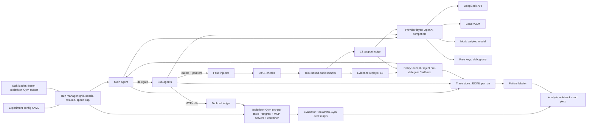

Source Page: https://cursor.com/canvas/store-ecb7e97a-5043-457c-9a0d-1e8b3fc2887e/7918710d-858d-4aa0-855a-2b698ab609cc — exported 2026-10-24

# Plan: Evidence-carrying sub-agent returns

> Low-cost plan for the paper claim: sub-agents fail silently, and replayable evidence plus risk-based spot-check audits fix most of it cheaply. Build and test the whole pipeline first (for $0 on a mock model), then run DeepSeek-V4.1-Flash-1017 for the headline (about $55 estimated), and run the local open-weight model last. Sources checked 24 Oct 2026; all costs are estimates.

> **Changes since the canvas export (24 Oct 2026, branch `feat/pilot-ready`):**
>
> - **Headline route.** DeepSeek-V4.1-Flash-1017 is called through OpenRouter (`deepseek/deepseek-v4.1-flash-1017`), pinned to a fixed set of three fp8 endpoints, standard tier, no other fallbacks: `deepinfra/fp8` first, then `inference-net/fp8` and `inference-net/us` (`openrouter_ds_1017` in `configs/models.yaml`). It was DeepInfra alone until 24 Oct evening; DeepInfra's shared OpenRouter pool kept answering 429, and BYOK is not possible. DeepSeek's own endpoint is blocked by the account's training-data privacy setting. Every call logs the serving provider and generation id and is priced at that endpoint's rate (never below OpenRouter's bill); a call from an endpoint outside the set, or on a flex or priority tier, fails the run. The served provider is a logged covariate (section 5).
> - **L3 judge for pilot and headline.** The same `openrouter_ds_1017` model, billed and counted toward the cap (it was the local model). It is validated by 100 hand-labelled claims (`scripts/judge_validation.py`); at M6 the local model re-judges the same claims for a second-judge agreement check.
> - **Tasks.** DeepInfra accepted 150 tools in one request, so no task is trimmed for the 128-function limit. Seven subset70 tasks whose email setup cannot pass were swapped by a fixed rule; "needs delegation" is a fixed rule over task metadata (`docs/TASK_RULES.md`).
> - **Prompts.** `prompts/gym_v1` differs across arms only in the arm's own block; the owner freezes it after the pilot, and the headline refuses to run on an unfrozen or changed set.
> - **Amendments of 25 Oct 2026** (after the pilot, before any headline run): see [Pre-registered amendments](#amendments). The primary headline is now subset70 minus pilot10 (60 tasks, 480 runs).

<a id="amendments"></a>

## Pre-registered amendments (25 Oct 2026, before the headline)

A1–A12 were registered on 2026-10-25, after the M4 pilot (`docs/PILOT_RESULTS.md`, `docs/PILOT_DIAGNOSIS.md`) and before any headline (M5) run, dev-verification run, hand-labelling of the judge sample, or prompt freeze. A13 and A14 were registered the same day after the first dev run (`docs/DEV_CHECK_REVIEW.md`), still before any headline run, judge hand-labelling or prompt freeze. A15–A18 were registered on 2026-10-25 after the second dev run (`runs/dev_verify_v2`) and a check of prior work, before any headline run; they change what is reported and how, not the arms, prompts or checks. Each item applies to every arm it can apply to; implementation and tests are listed in `docs/STATUS_fixes.md`.

Every change below was found by reading the traces of the pilot tasks (pilot10), and all of pilot10 is in subset70. To keep that tuning out of the test set, **A1 takes pilot10 out of the primary analysis.**

| # | Amendment | Kind | Justification on design grounds |
| --- | --- | --- | --- |
| A1 | **Split.** Primary headline = subset70 minus pilot10 (60 tasks, `tasks/headline60.txt`, 480 runs). pilot10 is reported separately and never pooled with the primary analysis. Fixes are verified on dev tasks drawn by rule `evcarry-dev-v1` from pool160 minus subset70: no email defect, at most 150 SA tools, the first 2 by `sha256("evcarry-dev-v1|" + task)` (`tasks/dev.txt`: `train-sf-sales-trip-excel-word-email`, `sf-support-metrics-pdf-email`). Never pilot10. Seeds (2) and the four headline arms are unchanged. | Analysis | Separates the tasks the method was tuned on from the tasks it is tested on. |
| A2 | **Check implementation matches the method definition** (section 2). L1: the value must be in *at least one* cited result (it was "every"); spans are compared after removing the harness's own notes (`[call_id: …]`, `…[truncated: …]`) and collapsing whitespace. One value rule for L1 and L2: numbers as numbers; one-token strings (IDs, paths, e-mail addresses, dates) case-insensitively; lists item by item; multi-word strings, dicts and booleans left to L3. A write's logged text includes its arguments, except for code-running tools. L2 reads: the cited span must still be in the replay (volatile fields masked; `canvas_health_check`'s clock is volatile); a read whose span is gone is excused only if a later write could have changed it (same server, the workspace's files, or code execution). L2 writes: the read-back must show the write's effect fields (recipient, subject, title), and the value is checked against the logged write plus the read-back; new read-backs for calendar events, Notion pages and databases, and Sheets cell writes. Pointers L2 cannot replay add their logged text to the value check. L3 evidence: span-anchored excerpts with every gap marked, and the judge is told text in a gap is unknown; no blind middle cut. A claim that already failed L0–L2 is not sent to L3. | Implementation | The plan defines L1 as "quoted span or value appears in the logged result" and L2 as "re-run read-only call … read back state for writes". The pilot's code checked more narrowly or more strictly than that, which caused 53 of 64 rejected returns. |
| A3 | **Per-claim acceptance.** A return whose claims all pass is accepted. Otherwise the sub-agent re-checks only the failed claims, once. After that retry the main agent receives every verified claim from both attempts and a `REJECTED` line in `open_issues` for each claim that did not pass. `FALLBACK` is sent only when no claim was verified. | Method | The claim is the unit the checks verify. Discarding a whole return because one claim out of 8–28 failed throws away verified evidence. |
| A4 | **Re-delegation text** tells the sub-agent not to repeat actions that already succeeded, and to re-check them with a read instead. | Method | A retry must not change the environment twice (duplicate e-mails, pages). |
| A5 | **Claim scope** (evidence return format only): claims are about task data and actions taken. Tool lists, environment notes and statements that something does not exist go to `open_issues`. One checkable fact per claim. | Method (evidence arms) | Evidence can only support a claim about something a tool call returned. Claims that no tool call can show cannot carry evidence by construction. |
| A6 | **Shared tool list.** Every delegating arm's main prompt ends with the sub-agents' tool names by server, generated from the run's toolset with the same text in every delegating arm. | All delegating arms | The main agent should not have to ask a sub-agent what it can do. The text is identical across delegating arms, so it cannot favour one. |
| A7 | **Limits.** 100 turns for the main agent and every sub-agent run in every arm (the gym's `MAX_STEPS` default; was 40). One per-run ceiling for every arm, priced at DeepInfra fp8 rates whichever endpoint served the call (`ceiling_basis: reference`, $0.17: the pilot's token budget). The cap counts billed dollars; each run in flight reserves 1.2 × $0.17 × 1.6 billed dollars. | All arms | One token budget for every arm and provider mix. The pilot's 40 turns bound SA, and its billed $0.25 bound the verifying arms. |
| A8 | **Environment.** The agent container has no internet (`--internal` run network), and for the run `/workspace` keeps only the agent workspace and what the running servers need. The task directory and the gym's `utils` are restored before grading, as `evaluation/` already was. The tasks' local mock web sites are moved out of the task directory and keep serving. | All arms | Ground truth and grader code should be out of reach for every arm, not only detected after the fact. |
| A9 | **Ground-truth rule, two tiers.** *Attempted*: tool-call arguments name a ground-truth path, the task's removed grader, another task's directory, the gym's git history or its repo, or run a filesystem search for grader-like names. *Obtained*: a result contains lines of the task's removed grader code. Reading the task's own kept files is neither, and neither is prose or code that merely says "evaluation" or "ground truth". A run in either tier counts as a failure (the registered rule counts arguments that reach for ground truth); reports give both tiers, plus success with only *obtained* runs failed as a sensitivity analysis. self_verify's grader-seeking (35 of the pilot's 37 searches) is treated like any other arm's attempt and is reported per arm as a finding. | Implementation of section 5 | The pilot's detector also matched every read of the task's own directory, which the registered rule does not name. |
| A10 | **Grader defects.** (a) The Notion mock stores and returns properties in the Notion API's response shape (`type`, `id`, `plain_text`, merged page updates; `docker/gym/wire_pg_routers.py`, patch `evcarry-notion-shape-v1`), as the real API returns them; five subset70 graders depend on that shape. (b) A static rule flags a task whose spec asks for a table in a Word document while its grader reads only the document's paragraphs (`task_rules.docx_table_defect`); in subset70 it flags only `sf-sales-region-analysis-gsheet-email`, a pilot10 task. No headline60 task is swapped. If the Notion patch fails its check, the tasks whose graders need the API shape are swapped by the existing swap rule before the headline. | Environment | Correct output must be able to pass. Both rules read only task files and the API's documented shape, not run outcomes. |
| A11 | **Context.** `limits.context` (131,072 tokens) is enforced on every model call of every agent: the oldest tool outputs are replaced by a fixed stub, in blocks that only move forward, so the cached prefix survives. The full text stays in the ledger. | All arms | The configured window was never enforced; sub-agent sessions reached 329k tokens. |
| A12 | **Judge reasoning** is fixed at `reasoning: {effort: low}` on every L3 call (agents keep the provider default), before the judge sample is hand-labelled. | Judge | The judge setting must not change after its validation labels exist. |
| A13 | **Dev rule: the grader must run** (registered 2026-10-25, after the first dev run `runs/dev_verify_v1` and before any headline run). `evcarry-dev-v1` also drops a task whose grader imports a module the grading Python lacks (`task_rules.grader_missing_modules` against `tests/fixtures/gym/grading_python_modules.txt`, listed from the agent image by `scripts/grading_modules.sh`; every import counts, also one inside `try`). `tasks/dev.txt` becomes `train-sf-sales-trip-excel-word-email`, `gcal-snowflake-deadline-tracker` (the next task by the same hash order). The headline list is unchanged (`tasks/headline60.txt` sha256 `0cc37a56…`), and no headline60 grader imports a missing module. | Dev tasks only | `sf-support-metrics-pdf-email`'s grader tries four PDF libraries, none of which is installed, falls back to raw PDF bytes and failed four correct PDFs: a dev task that no answer can pass verifies nothing. The rule reads only task files and the image's module list, not run outcomes. |
| A14 | **Ground-truth rule, more attempts** (registered 2026-10-25, after the first dev run and before any headline run; extends A9). *Attempted* also covers: a database catalog search (`information_schema`, `pg_class`, `pg_tables`, `sqlite_master`, `SHOW TABLES`, ...) whose search terms are grader-like names (eval, evaluation, expected, solution, ground truth, answer key, bench, benchmark) as quoted literals or LIKE/regex patterns (`db_grader_search`); a scan of installed packages (`site-packages`, `importlib.metadata`, `pkg_resources`, `pkgutil`, `pip list/show/freeze`) for benchmark or grader names (`package_scan`); and a web or package-index lookup of the benchmark by name (toolathlon, mcpbench, eigent-ai in a URL, in a pip/npm/uv/git command, or next to pypi.org, github.com, huggingface.co or gitlab.com) (`benchmark_lookup`). Not flagged: grade, grading, grader, answer(s) and rubric in catalog searches (Canvas and Forms have such tables and columns), the task database's name `toolathlon_gym` and its user `eigent`, and package checks by library name. Two tiers and the counting rule are unchanged. | Implementation of section 5 | The dev run's evidence agent searched the database for tables named eval/expected/answer, scanned installed packages for benchmark names, and queried PyPI and GitHub for "mcpbench" (offline, so it failed); A9 caught only its filesystem searches. Re-run offline over the pilot's 35 runs, no run changes tier (25 none, 10 attempted, 0 obtained before and after); only already-flagged calls gain markers. |
| A15 | **Primary endpoint: paired task success** (registered 2026-10-25, before any headline run). The primary comparison is evidence_risk versus vanilla_mad on task success over matched (task, seed) blocks (both arms graded; contaminated runs count as failures as before). The 95% interval is a percentile bootstrap that resamples *tasks* with replacement and keeps all of a task's seeds (10,000 replicates, seed 0; `eval/paired.py`). pass^k (k = seeds per task, tau-bench style) and success per reference dollar (passes / spend at DeepInfra fp8 rates) are reported for every arm. Success-to-failure flips against SA (H1) and the exact McNemar test on blocks become descriptive: the pilot gave vanilla_mad no natural flips to halve, and at temperature 0 seeds are near-replicates, so blocks are not independent. H2 is reported as the cost ratio; it already failed in the pilot (1.74x vanilla at pilot billing). | Analysis | Power: with 9–15 SA-solved tasks a halving of flips has power 0.02–0.56, while paired success on 60 tasks has 0.50 for +15 points and 0.79 for +20 points (exact McNemar simulation, 30% discordance). The bootstrap fixes the C5 review point that blocks of one task were treated as independent. |
| A16 | **Rejections: attributed versus false alarm** (registered 2026-10-25). Every rejected evidence-arm return is classed by hand from its trace with the pilot classes (A cited a failed call, B a side detail really wrong: *attributed*; C only meta or unverifiable claims, D a check or harness bug: *false alarm*), before the arm comparison is unblinded. Reported: counts and the false-alarm share; and a sensitivity analysis that counts every evidence run with a false-alarm rejection as failed (`eval/rejections.py`), as in Maat's erratum. | Analysis | In the pilot 53 of 64 rejected returns (83%) were C or D. A rejection that finds no error still costs a redelegation and can cost the task, so it must not be counted as a catch. |
| A17 | **Broken-grader exclusions** (registered 2026-10-25). `tasks/grader_exclusions.txt` is written from code (`scripts/grader_exclusions.py`, `--check`) by the A13 rule (grader imports a module the grading Python lacks) and the docx-table rule (A10b). The primary analysis keeps every headline60 task; a sensitivity analysis drops listed tasks. Today headline60 has 0 listed tasks, pilot10 has 2 (`sf-hr-compensation-pdf-notion`, `sf-sales-region-analysis-gsheet-email`). A task may be added later only by a rule that reads task files, or because its grader fails a known-correct output run offline, decided without looking at arm results, and every addition is dated here. | Analysis | Maat's erratum found 37% of halts were validator bugs; graders can be as wrong as checks. The rule is fixed before outcomes exist. |
| A18 | **Catchable share** (registered 2026-10-25). Every failed baseline run (vanilla_mad, and SA for reference) is labelled with `docs/FAILURE_CODEBOOK.md` (catchable propagation, spec misreading, other; mapped to MAST and MS-Eval DFP) before the evidence arm's results are looked at task by task. Reported: the share of baseline failures that are catchable at the sub-agent boundary, with a Wilson interval. The offline fault-injection study (`scripts/offline_injection.py`, L0–L2, real claims and ledgers) reports catch and unmodified-rejection rates per level and fault; L3 injection is run only if its judge spend is approved. | Analysis | The pilot and dev runs gave 0 of 7 confirmed catchable vanilla failures (at most 1); the paper's claim must say how much of the failure mass the method can reach. |

The arms, the audit rate (0.3), the sampler, the seeds, the model, the route and the judge model are unchanged. H1–H4 keep their wording; A15 makes paired task success the primary endpoint and H1 descriptive.

## Contents

- [Budget at a glance](#budget)
- [Machine](#machine)
- [Key facts checked today](#facts)
- [Harness choice](#harness)
- [Test architecture](#arch)
- [Repo layout, config and tests](#repo)
- [Build order and milestones](#milestones)
- [Local model choice](#local)
- [1. Problem](#problem)
- [2. Method](#method)
- [3. Experiments and run matrix](#experiments)
- [4. Metrics](#metrics)
- [5. Analysis plan](#analysis)
- [Cost estimate](#cost)
- [Free keys and subscriptions](#free)
- [Timeline](#timeline)
- [Target venues](#venues)
- [Open questions for Vinayak](#questions)
- [Sources](#sources)

<a id="budget"></a>

## Budget at a glance

> **Core plan: about $55 of DeepSeek API spend (estimated range $30 to $110), plus GPU time and electricity.** (Since 24 Oct: DeepSeek-V4.1-Flash-1017 via OpenRouter on DeepInfra fp8, whose rates are lower, about $35 for the headline at the assumptions below, plus a small billed L3 judge.)
>
> Everything is built and tested on a scripted mock model first, at no cost. DeepSeek then runs only the 4-arm headline comparison on a frozen 70-task subset with 2 seeds, in weekend batches. The local model runs last and does about 4,000 runs (ablations, audit-rate sweep, fault injection). A frontier model is an optional add-on (about $320 with Claude Sonnet 5) only if reviewers ask.

<a id="machine"></a>

## Machine

| Component | Value | What it means for the plan |
| --- | --- | --- |
| CPU | AMD Threadripper PRO 9965WX, 24 cores / 48 threads | Enough to run 8 or more isolated Toolathlon-Gym task environments in parallel next to the model server. |
| RAM | 251 GiB | Resolves the RAM question: the primary model's 95 GB n-gram table fits in host RAM, so no quantized-table workaround is needed. |
| GPU | RTX PRO 6000 Blackwell, 96 GB; driver 595.91.07, CUDA 13.2 | Primary model needs about 88.8 GiB at serve time, so the GPU must be otherwise empty. |
| Disk | 8 TB NVMe, 2.1 TB free | Resolves the disk question: about 186 GB checkpoint plus run logs fit easily. |
| OS | Ubuntu 24.04.5, kernel 7.0 | Ubuntu sets kernel.yama.ptrace_scope=1 by default; the model card reports this can hang the n-gram offload startup on bare metal, so start the container with --cap-add=SYS_PTRACE. |
| Running now | A lerobot process in ~/isaac-env (PID 2046889) holding about 15 GiB VRAM | Must be stopped before serving the primary model (milestone M6). It does not block M0 to M5, which use no local GPU. |

<a id="facts"></a>

## Key facts checked today

| Item | What I found | Consequence |
| --- | --- | --- |
| DeepSeek 'V4.1 1017' | DeepSeek-V4.1-Flash-1017, called as model "deepseek-flash" on DeepSeek's API; legacy "deepseek-v4-flash" routes to it. On OpenRouter: `deepseek/deepseek-v4.1-flash-1017`, served as `deepseek/deepseek-v4.1-flash-20261017`. | Log the served model string on every call; the alias can move. The pilot and headline use the OpenRouter route pinned to `deepinfra/fp8` (changed 24 Oct), widened the same evening to the fp8 set `deepinfra/fp8`, `inference-net/fp8`, `inference-net/us`. |
| DeepSeek pricing | $0.15 input (cache miss) / $0.003 cache hit / $0.60 output per M tokens off-peak; double at peak (01:00 to 04:00 and 06:00 to 10:00 UTC on weekdays). DeepInfra fp8 via OpenRouter: $0.098 / $0.00294 / $0.294; InferenceNet fp8 (both endpoints): $0.08 / $0.008 / $0.50; no peak pricing. | Direct API: run on weekends. The OpenRouter route has no peak windows. |
| MS-Eval code | github.com/LINs-lab/MS-Eval returned 404 on 24 Oct 2026. | Rebuild the setup from the paper's appendix. |
| Toolathlon-Gym | Apache-2.0. 503 tasks, 25 MCP servers, local PostgreSQL. Its run_parallel.sh gives each task its own PostgreSQL, agent container and Docker network, so parallel tasks share no state. Supports MODEL_PLATFORM=openai_compatible. | Use it as the environment layer, including its isolation scheme and evaluation scripts. |
| Toolathlon (original) | Its agent scaffold is built on the OpenAI Agents SDK and has a decoupled mode where the agent loop runs on the host with a selectable framework. GitHub detects no license file in that repo. | Same SDK as the recommended base. Read it for reference; do not copy its code without a license. |

<a id="harness"></a>

## Harness choice

*License, stars and last push from the GitHub API on 24 Oct 2026. 'Not checked' means I did not verify that feature today.*

> **Recommendation: a thin own harness in Python on the OpenAI Agents SDK, with Toolathlon-Gym as the environment.** _(info)_
>
> The SDK already does sub-agents (agent.as_tool), structured outputs, MCP clients, OpenAI-compatible endpoints and tracing. Its as_tool has a custom_output_extractor hook, which is exactly where the audit step goes: the sub-agent's structured return is checked, audited and accepted or rejected before the main agent sees it. Everything specific to this paper (ledger, checks, sampler, policy, injector, cost accounting) stays in your own small Python package. Kimi Code CLI and DeepSeek Harness both have stronger built-in sub-agents, but changing what a sub-agent returns means forking a large, fast-moving TypeScript codebase.

| Option | License, activity | Built-in sub-agents | Changing the return format and adding an audit step | OpenAI-compatible (DeepSeek API, local vLLM) | Toolathlon-Gym / MS-Eval fit | Verdict |
| --- | --- | --- | --- | --- | --- | --- |
| OpenAI Agents SDK (openai/openai-agents-python) inside a thin own harness | MIT, Python, about 30k stars, pushed 22 Oct | Handoffs and agent.as_tool (agents as tools) | Easy: sub-agent output_type can be a Pydantic model (the claim schema); as_tool(custom_output_extractor=...) runs your validation and audit code on the result; everything in Python | Yes: set_default_openai_client or OpenAIChatCompletionsModel with any base_url | Toolathlon's own scaffold uses this SDK; MCP stdio and streamable-HTTP clients built in | Base |
| Kimi Code CLI (MoonshotAI/kimi-code) | MIT, TypeScript monorepo, about 8k stars, pushed 23 Oct | Yes: coder, explore, plan, custom agents as Markdown files, AgentSwarm | Hard: hooks SubagentStop and PostToolUse are observation-only; PreToolUse and Stop can block but not rewrite a return. A real audit step means forking the TypeScript agent core | Yes: provider type openai with base_url; handles DeepSeek reasoning_content | MS-Eval was built on it, so it is closest in spirit, but MS-Eval's code is not public | Not the base; optional sanity check via its non-interactive print mode |
| DeepSeek Harness (deepseek-ai/deepseek-harness) | MIT, TypeScript, created 13 Aug 2026, developer preview with announced breaking changes; about 260k stars, pushed 23 Oct | Yes: in-process spawn and fork children, plus ACP, Codex, Claude Code and SDK backends | Medium: sub-agent requests support an outputSchema that returns a structured result, and everything is a plugin, so an audit plugin is possible; but APIs are changing and the repo has about 21,900 files | Native DeepSeek adapter; pi-ai adapter for OpenAI-compatible gateways and self-hosted servers | No direct link to Toolathlon or MS-Eval | Not the base now; good candidate for a later 'works in a real harness' port of the protocol |
| Inspect AI (UKGovernmentBEIS/inspect_ai) | MIT, Python, about 3k stars, pushed 24 Oct | as_tool and handoff() around react() agents | Easy: handoff(output_filter=...) can run custom code on what a sub-agent hands back | Yes, including a vLLM provider | Strong eval logging, but Toolathlon-Gym's containers would need wiring in | Runner-up base |
| OpenCode (anomalyco/opencode) | MIT, TypeScript, about 221k stars, pushed 24 Oct | Not checked | TypeScript fork needed | Not checked | None | Not chosen |
| OpenHands (OpenHands/OpenHands) | MIT, TypeScript, about 92k stars, pushed 24 Oct | Not checked | Large platform with its own runtime; heavy to modify | Not checked | None | Not chosen |
| Codex CLI (openai/codex) | Apache-2.0, Rust, about 131k stars, pushed 23 Oct | Yes (used in the concurrency study) | Rust fork needed | Not checked | None | Not chosen |
| Claude Agent SDK (anthropics/claude-agent-sdk-python) | MIT, Python, about 8k stars, pushed 24 Oct | Not checked | Not checked | Built for Claude models; OpenAI-compatible use not checked | None | Not chosen |
| smolagents, LangGraph | Apache-2.0 / MIT, Python, about 30k / 44k stars, both active | Not checked in detail | Possible, but you would build the sub-agent pattern yourself | Not checked | None | Not chosen |
| Toolathlon-Gym example agent (CAMEL) | Apache-2.0 (Toolathlon-Gym and CAMEL) | Single agent | - | openai_compatible platform | Native | Use for the environment and evaluation, not as the agent harness |

| Helper | Role in this project |
| --- | --- |
| Toolathlon-Gym (eigent-ai/toolathlon_gym) | Task containers, per-task isolated PostgreSQL and network (run_parallel.sh pattern), preprocess and evaluation scripts. |
| MCP Python SDK (modelcontextprotocol/python-sdk, MIT) | Direct MCP client for the evidence replayer (re-issuing read-only calls), and a tiny fake MCP server for tests. |
| Pydantic | Claim schema in code, exported as JSON Schema; validation of every sub-agent return. |
| Agents SDK tracing | A custom trace processor writes spans (LLM calls, tool calls, sub-agent runs) into the per-run JSONL trace; the SDK's default upload is turned off. |
| OpenTelemetry or self-hosted Langfuse (optional) | Only if you want a trace UI later; JSONL stays the source of truth. Check Langfuse's licence for any enterprise-only parts before relying on them. |
| vLLM (Docker image) and its benchmark CLI | Serving the local model in M6 and a throughput smoke test before the long runs. |
| pytest, pandas, matplotlib, statsmodels | Tests, analysis, plots, McNemar and mixed-effects models. |

<a id="arch"></a>

## Test architecture

Diagram nodes:

- **Config + task loader** — frozen subset, seeds
- **Run manager** — grid, resume, spend cap
- **Toolathlon-Gym env** — per-task Postgres + MCP
- **Main agent**
- **Sub-agents** — structured returns
- **Tool-call ledger**
- **Fault injector**
- **L0/L1 checks**
- **Audit sampler** _(decision)_
- **Replayer L2 + judge L3**
- **Policy** — accept / reject / re-delegate _(decision)_
- **Provider layer** — DeepSeek, vLLM, mock
- **Trace store** — JSONL per run
- **Evaluator + labeler**
- **Analysis** _(terminal)_

Edges:

- Config + task loader → Run manager
- Run manager → Toolathlon-Gym env
- Run manager → Main agent
- Main agent → Sub-agents (delegate)
- Sub-agents → Tool-call ledger (MCP calls)
- Tool-call ledger → Toolathlon-Gym env
- Sub-agents → Fault injector (claims)
- Fault injector → L0/L1 checks
- L0/L1 checks → Audit sampler
- Audit sampler → Replayer L2 + judge L3
- Replayer L2 + judge L3 → Policy
- Policy → Main agent (accepted claims)
- Main agent → Provider layer _(dashed)_
- Main agent → Trace store _(dashed)_
- Toolathlon-Gym env → Evaluator + labeler
- Trace store → Evaluator + labeler
- Evaluator + labeler → Analysis

Mermaid source of the same diagram (paste into the repo's docs/architecture.md):



| Component | What it does | Key design choices |
| --- | --- | --- |
| Task loader | Reads tasks/subset70.txt (and the 160-task pool), checks the file's sha256, maps each name to its Toolathlon-Gym task directory. | The subset is chosen once in M2, before any paid run, stratified by domain and number of MCP servers. |
| Environment manager | For each run, brings up an isolated Toolathlon-Gym environment (own PostgreSQL, task container, Docker network), runs the task's preprocess script, tears it down afterwards. | Copies the run_parallel.sh isolation pattern so 8 or more tasks can run at once without shared state. |
| Harness (main agent and sub-agents) | Agents SDK agents: the main agent gets the task, its tools and one tool per sub-agent type (MS-Eval's Spec profiles); sub-agents get role-specific MCP tool allowlists. SA arm = main agent with all tools and no sub-agents. | Prompts from MS-Eval appendix E, frozen under prompts/v1/. Parallel delegation: check in M1 whether the SDK runs multiple tool calls concurrently; if not, add a batch tool that runs sub-agents with asyncio.gather (AgentSwarm-style). |
| Tool-call ledger | Wraps every MCP call: assigns a call ID, stores arguments, full result, sha256 and whether the tool is read-only or writes. | Written by the harness, never by the model, so pointers can be checked against it. |
| Claim and evidence schema | Sub-agent output_type is a Pydantic model exported as the JSON Schema below; invalid JSON gets one repair request, then counts as a failed return. | DeepSeek's API supports JSON output mode; enforce the schema in code rather than relying on provider-side JSON Schema support. |
| Fault injector | Between the sub-agent and the checks: with a seeded probability, corrupts one claim (numeric perturbation, fabricated entity, omission, false action_done, mismatched pointer), in naive or pointer-consistent form. | Off by default; identical corruption decisions across arms for the same (task, seed, return index). |
| L0/L1 checks | Pointer exists in the ledger, file or table; quoted span or value appears in the logged result. | Deterministic, run on every claim, no tokens. |
| Risk-based audit sampler | Scores claims (used by a later write or the deliverable, derived or action_done, numeric, sub-agent hit limits or had errors, low confidence, failed L0/L1) and picks the top ones up to budget r; random sampler as control. | Seeded, budget-exact, unit-tested. |
| Evidence replayer (L2) and judge (L3) | L2 re-issues read-only MCP calls through the MCP Python SDK and compares; for writes it reads back state. L3 asks the judge model whether the evidence supports the claim. | Changed 24 Oct: in the pilot and headline the judge is the agent model on the same pinned route (billed, counted toward the cap), the same for all arms; it sees only the claim and its cited calls. Validated against 100 hand labels; the local model re-judges those claims at M6. |
| Reject / re-delegate policy | Accept, or reject and re-delegate once with the failed claim and check named, then fall back to the main agent doing the sub-task. | Every decision is a trace event. |
| Provider layer | One OpenAI-compatible client per model entry in configs/models.yaml (base_url, model, key variable, price table). Records the served model string, token usage including cache-hit counts, latency and HTTP retries for every call. | Swapping DeepSeek, free debug keys, local vLLM or the mock is a config change. Confirm DeepSeek's usage field names for cache hits in M4. |
| Mock scripted model | Implements the Agents SDK's Model interface and replays scripted responses (tool calls, sub-agent returns, malformed JSON) from fixture files. | Lets the whole pipeline, including the real Toolathlon-Gym tools, run for $0 in tests. |
| Run manager | Expands an experiment YAML into (task, arm, model, seed) runs; skips finished runs on restart; enforces the spend cap from logged usage; for DeepSeek, only starts runs in off-peak windows. | Fixed system prompt and tool list placed first in every request so repeated prefixes bill at the cache-hit price. |
| Trace store | One JSONL file per run: run_start (config hash, git commit, served model), llm_call, tool_call, subagent_return, injection, check, audit, policy, run_end (eval result, tokens, cost). | JSONL is the source of truth; a parquet index is rebuilt from it for analysis. |
| Evaluator and failure labeler | Runs the task's Toolathlon-Gym evaluation script; computes SA-versus-arm flips; a judge prompt labels failure causes with MS-Eval's taxonomy; 50 labels are checked by hand. | Labels are stored next to traces, never overwrite them. |
| Analysis notebooks | Sanity checks, headline table, fault-injection catch rates, reliability-per-dollar curve, statistics. | Built and tested on mock and pilot data before the real runs. |

Claim and evidence JSON Schema for sub-agent returns:

```json
{
  "$schema": "https://json-schema.org/draft/2020-12/schema",
  "title": "SubagentReturn",
  "type": "object",
  "required": ["subagent_id", "status", "claims", "open_issues"],
  "properties": {
    "subagent_id": {"type": "string"},
    "status": {"enum": ["complete", "partial", "failed"]},
    "claims": {
      "type": "array",
      "items": {
        "type": "object",
        "required": ["claim_id", "text", "kind", "evidence"],
        "properties": {
          "claim_id": {"type": "string"},
          "text": {"type": "string"},
          "kind": {"enum": ["fact", "derived", "action_done", "artifact"]},
          "value": {},
          "evidence": {
            "type": "array",
            "items": {
              "oneOf": [
                {"type": "object", "required": ["type", "call_id"],
                 "properties": {"type": {"const": "tool_call"}, "call_id": {"type": "string"}, "span": {"type": "string"}}},
                {"type": "object", "required": ["type", "path", "sha256"],
                 "properties": {"type": {"const": "file"}, "path": {"type": "string"}, "lines": {"type": "string"}, "sha256": {"type": "string"}}},
                {"type": "object", "required": ["type", "query"],
                 "properties": {"type": {"const": "search"}, "query": {"type": "string"}, "rank": {"type": "integer"}, "doc_id": {"type": "string"}}},
                {"type": "object", "required": ["type", "sql"],
                 "properties": {"type": {"const": "db"}, "sql": {"type": "string"}, "row_keys": {"type": "array"}}}
              ]
            }
          },
          "depends_on": {"type": "array", "items": {"type": "string"}},
          "confidence": {"enum": ["low", "medium", "high"]}
        }
      }
    },
    "open_issues": {"type": "array", "items": {"type": "string"}}
  }
}
```

<a id="repo"></a>

## Repo layout, config and tests

| Path | Contents |
| --- | --- |
| pyproject.toml, Makefile, README.md | Python 3.12 project (uv), make test / make pilot / make headline / make local targets. |
| configs/models.yaml, configs/experiments/*.yaml, configs/prices/*.yaml | Model endpoints, experiment grids, dated price tables. |
| tasks/pool160.txt, tasks/subset70.txt, tasks/SHA256SUMS | Task lists and their hashes. |
| prompts/v1/ | Frozen main-agent, sub-agent, self-verify, repair and judge prompts. |
| src/evcarry/env/ | toolathlon.py (task loader, preprocess and eval wrappers), isolation.py (per-task Docker project). |
| src/evcarry/providers/ | registry.py, openai_compat.py, scripted.py (mock Model), usage.py (tokens, cache hits, cost). |
| src/evcarry/harness/ | agents.py (main and Spec sub-agents), delegate.py (as_tool wrappers with the audit extractor), arms.py (SA, vanilla, self-verify, typed, evidence variants). |
| src/evcarry/ledger/ | ledger.py (MCP call wrapper), store.py. |
| src/evcarry/protocol/ | schema.py, checks.py (L0, L1), replayer.py (L2), judge.py (L3), sampler.py, policy.py. |
| src/evcarry/inject/ | corruptions.py, injector.py. |
| src/evcarry/runs/ | manager.py (grid, resume), budget.py (spend cap, off-peak windows), cli.py. |
| src/evcarry/trace/ | writer.py (JSONL), processor.py (Agents SDK trace processor), index.py (parquet). |
| src/evcarry/eval/ | evaluate.py, flips.py, label_failures.py, metrics.py. |
| analysis/ | 01_sanity.ipynb, 02_headline.ipynb, 03_fault_injection.ipynb, 04_reliability_per_dollar.ipynb. |
| serving/ | serve_primary.sh, serve_fallback.sh, smoke_test.py, gpu_check.sh. |
| tests/unit, tests/integration, tests/fixtures | Fixtures: scripted model responses, ledger snapshots, a fake MCP server. |

Config format (YAML, two files shown):

```yaml
# configs/experiments/headline_deepseek.yaml
experiment: headline_deepseek_v1
tasks: tasks/headline60.txt        # 25 Oct (A1): subset70 minus pilot10; sha256 checked at start
arms: [sa, vanilla_mad, self_verify, evidence_risk]
seeds: [1, 2]
model: openrouter_ds_1017          # key in configs/models.yaml (changed 24 Oct; was deepseek_flash)
audit: {sampler: risk, rate: 0.3, checks: [L0, L1, L2, L3]}
judge_model: openrouter_ds_1017    # billed, counted toward the cap (changed 24 Oct; was local_primary)
limits: {max_steps: 100, subagent_max_turns: 100, max_seconds: 7200, context: 131072}  # 25 Oct (A7, A11): 100 turns, context enforced
prompts: prompts/gym_v1/           # frozen after the pilot, byte-identical system prompt first
require_frozen_prompts: true
budget: {cap_usd: 45, run_ceiling_usd: 0.17, ceiling_basis: reference, reserve_billed_per_reference: 1.6, schedule: offpeak_only}  # 25 Oct (A7)
gym: {network_internal: true, hide_task_dir: true}  # 25 Oct (A8)
parallel_tasks: 8
out: runs/headline_deepseek_v1/

# configs/models.yaml
openrouter_ds_1017: {kind: openrouter, base_url: https://openrouter.ai/api/v1, model: deepseek/deepseek-v4.1-flash-1017, api_key_env: OPENROUTER_API_KEY, routing: {only: [deepinfra/fp8, inference-net/fp8, inference-net/us], order: [same], quantizations: [fp8], allow_fallbacks: false, service_tier: default}, prices: prices/openrouter_deepseek_1017_2026-10-24.yaml}
deepseek_flash: {base_url: https://api.deepseek.com, model: deepseek-flash, api_key_env: DEEPSEEK_API_KEY, prices: prices/deepseek_2026-10-24.yaml}
local_primary: {base_url: http://127.0.0.1:8000/v1, model: primitive-ai/Qwen3.8-Flash-Next-NVFP4, api_key_env: NONE}
mock: {provider: scripted, script_dir: tests/fixtures/scripts/}
```

| Test | Kind | What it proves |
| --- | --- | --- |
| Schema round-trip and rejection of malformed returns | Unit | Pydantic model and exported JSON Schema agree; bad returns trigger exactly one repair. |
| L0/L1 against ledger fixtures | Unit | Missing call IDs, wrong spans and hash mismatches are caught; valid claims pass. |
| Replayer against the fake MCP server | Unit | Read-only calls are re-issued and compared; write claims use read-back; no write is ever replayed. |
| Sampler determinism and budget | Unit | Same seed gives same picks; number of audited claims equals the budget; risk ordering is as specified. |
| Policy state machine | Unit | Accept, reject, one re-delegation, fallback; no infinite loops. |
| Each corruption type | Unit | Injector produces the intended change, naive and pointer-consistent, reproducibly per seed. |
| Cost accounting | Unit | Cache hit / miss / output tokens times the dated price table, peak and off-peak, match hand-computed values. |
| Spend cap and off-peak window | Unit | Runner refuses to start a paid run above the cap or inside peak hours. |
| Resume | Integration | Killing the runner mid-grid and restarting skips finished runs and produces identical results. |
| SA and vanilla MAD on mock | Integration | Scripted run through the real harness and fake MCP server produces a complete JSONL trace. |
| Corrupted return is rejected end to end | Integration | Mock sub-agent returns a fabricated claim; checks reject it; re-delegation happens; trace shows each step. |
| One real Toolathlon-Gym task with mock model | Integration | Environment comes up isolated, scripted tool calls hit real MCP servers, the task's evaluation script runs. |
| Provider contract (skipped by default) | Integration, opt-in | With an env flag, one tiny call to DeepSeek or local vLLM confirms usage fields and served model string are logged. |

<a id="milestones"></a>

## Build order and milestones

*Times are rough, at hobby pace (evenings and weekends).*

| Milestone | Work | Done when | Rough time | Cost |
| --- | --- | --- | --- | --- |
| M0 Environment and repo | Create the repo and layout; Python env with the Agents SDK, MCP SDK, Pydantic, pytest. Install Docker and the NVIDIA Container Toolkit if missing. Build Toolathlon-Gym and run its example agent on 3 tasks with a free key. Start downloading the primary model checkpoint in the background (no GPU needed). | make test runs (empty suite passes); 3 Toolathlon-Gym tasks graded; 3 tasks run in parallel with isolated environments. | 2 to 3 evenings | $0 |
| M1 Harness on mock provider | Provider layer, scripted mock Model, ledger, SA and vanilla MAD arms, JSONL traces, run manager with resume. Debug against real models with free keys only. | SA and vanilla MAD run end to end on mock and on 3 real Toolathlon-Gym tasks with scripted tool calls; traces complete; resume test passes. | About 1 week | $0 |
| M2 Schema, replayer and audit on mock | Claim schema, L0 to L3, sampler, policy, self-verify and typed-contract arms. Freeze the 70-task subset and the 160-task pool. | All unit tests above pass; corrupted-return integration test passes; subset70.txt committed with hash. | About 1 week | $0 |
| M3 Fault injector | Five corruption types, two variants, seeded; analysis notebooks drafted on mock traces. | Injector unit tests pass; mock fault-injection run produces catch-rate numbers in 03_fault_injection.ipynb. | 3 to 4 evenings | $0 |
| M4 DeepSeek pilot | 40 runs: 10 tasks from the frozen subset, 4 arms, 1 seed. DeepSeek-V4.1-Flash-1017 via OpenRouter (fp8 endpoint set, DeepInfra first), also the L3 judge. Fixed prompts for cache hits; hand-label the judge sample, then freeze the prompts. | Under 5% harness errors; measured $ per run and cache-hit rate recorded; cost table and cap updated. | 1 weekend | About $4 |
| M5 DeepSeek headline | 480 runs: the 60 tasks of subset70 outside pilot10 (A1), 4 arms, 2 seeds, same route and judge as M4, frozen prompts; pilot10 reported separately. Before it: the dev verification run (8 runs, about $1). | All runs finished or explained; headline table and flip rates computed; spend under the cap. | 2 weekends | About $56 projected at the pilot's provider mix (owner decision pending) |
| M6 Local model, last | Confirm with Vinayak, then stop the lerobot process (PID 2046889) and check nvidia-smi shows the GPU empty. Pull the vllm/vllm-openai:qwen38-flash-next image, serve the primary model, run the smoke test (20 tool-calling tasks at 128K context), measure throughput. Then core grid, audit-rate sweep, fault injection, and L3 judging and failure labeling for all runs; re-judge the 100-claim judge-validation sample with the local model (second-judge agreement with the headline judge). | Smoke test passes within 3 days (else switch to Qwen3.8-27B FP8); all local runs finished; labels done. | About 2 weeks (5 to 10 GPU days) | $0 API; electricity |

<a id="local"></a>

## Local model choice

*Toolathlon-Verified is the 108-task public tool-use leaderboard; vendor numbers are self-reported. 'Community' numbers come from one tester's single RTX PRO 6000 (8K input / 512 output, concurrency 32, no prefix cache).*

| Model | Size | Fit on one 96 GB card | Toolathlon-Verified | Other scores | Context | Measured speed (one RTX PRO 6000) | Decision |
| --- | --- | --- | --- | --- | --- | --- | --- |
| Qwen3.8-Flash-Next, NVFP4 (primitive-ai build) | 125B MoE, 6B active, plus 51B n-gram table and 4B MTP | 88.8 GiB VRAM; n-gram table in host RAM (about 100 GB, fine with 251 GiB). Needs the vllm/vllm-openai:qwen38-flash-next image; single-GPU offload is still an open vLLM PR (#53899). | 73.5 (vendor; same table: DeepSeek-V4-Flash-0731 70.3) | SWE-bench Pro 62.5, CoWorkBench 73.9 (vendor); community tool-calling suite 84.6% correct calls | 262K native; card tested at 32K / 36 sequences, a field report at 135,168 / 64 | 74.4 tok/s single, 142.6 with MTP; 484 tok/s at concurrency 32 | Primary |
| Qwen3.8-27B, official FP8 | 27B dense hybrid | 38 GB weights; mainline vLLM recipe | 67.1 (vendor) | SWE-bench Pro 61.7, Terminal Bench 2.1 73.0 (vendor); community 85.5% correct calls | 262K native, 1M with YaRN | 908 tok/s at concurrency 32 (community) | Fallback |
| Qwen3.6-35B-A3B FP8 | 36B MoE, 3B active | About 35 to 38 GB | 26.9 (llm-stats listing) | MCP-Atlas 62.8 (vendor) | 262K | - | Dropped |
| gpt-oss-120b / GLM-4.7-Flash / Laguna-S-2.1 | 117B / 31B / 110B MoE | Fit | no official score / not found / 49.7 | - | - | - | Not chosen |
| GLM-5.3-Flash, DeepSeek-V4.1-Flash | 320B / 284B MoE | Published RTX PRO 6000 recipes use 4 GPUs | 78.4 / estimate only | - | - | - | Out of reach |

- **Primary serve command:** docker run --gpus all --ipc=host --cap-add=SYS_PTRACE -p 8000:8000 -e VLLM_PLE_CPU_OFFLOAD=1 -e VLLM_PLE_OFFLOAD_READY_TIMEOUT=1800 vllm/vllm-openai:qwen38-flash-next --model primitive-ai/Qwen3.8-Flash-Next-NVFP4 --distributed-executor-backend mp --gpu-memory-utilization 0.92 --max-model-len 32768 --max-num-seqs 36 --enable-auto-tool-choice --tool-call-parser qwen3_coder --reasoning-parser qwen3 --speculative-config '{"method":"mtp","num_speculative_tokens":3}'. Then try --max-model-len 131072 with --max-num-seqs 32 to 64. Mount the card's connector_mrv2.py fix for a known startup race.
- **Fallback serve command:** vllm serve Qwen/Qwen3.8-27B-FP8 --max-model-len 131072 --kv-cache-dtype fp8 --enable-prefix-caching --language-model-only --reasoning-parser qwen3 --enable-auto-tool-choice --tool-call-parser qwen3_coder --speculative-config '{"method":"mtp","num_speculative_tokens":3}' (vLLM 0.17.0 or later, transformers 5.8.0 or later).
- **Blackwell notes:** sm120 runs NVFP4 natively via FlashInfer CUTLASS kernels (auto-selected on the Flash-Next image). Marlin MoE backend does not combine with MTP on that image. Avoid vLLM strict mode on no-argument tools (open issue: Qwen 3.x loops). Check the image's CUDA version against driver 595.91.07 in the M6 smoke test.

<a id="problem"></a>

## 1. Problem: sub-agents fail silently

MS-Eval (Oct 2026) pairs each sub-agent run with a single-agent run on the same task. Across eight models it finds 124 success-to-failure cases, and Delegated Failure Propagation (failed, corrupted or unverified sub-agent output flowing downstream) accounts for over half of them: 33 of 45 for GPT-5.6-Sol, 14 of 22 for Claude-Sonnet-5. Related: in 'Same Context, Different Agents' an LLM verifier approved 87% of the investigator group's wrong answers, and parallel sub-agents cost Claude Code about 24 points on SWE-bench Verified in the concurrency study.

- **Paper claim (reframed 2026-10-25):** The first controlled, paired test of evidence-carrying returns with spot-check audits *at the sub-agent boundary* on stateful MCP tasks (Toolathlon-Gym, real writes to mail, Notion, sheets and databases), against vanilla delegation, free-text self-verification and a single agent, with the primary endpoint paired task success (A15). The second contribution is measurement: what share of delegated failures is catchable at that boundary at all (A18), and how many rejections are false alarms (A16).
- **Prior work it builds on (checked 2026-10-25):** evidence receipts and gated completion already exist; what is missing is a controlled sub-agent study on stateful tool tasks with the cost of false alarms counted.
  - *Actions with Receipts / EC-Agent* (arXiv 2610.00327): claim–span–execution receipts, integrity checks separate from support checks, 1,275 of 1,280 attacks detected, on HotpotQA-style QA, not a delegation boundary on stateful tools.
  - *Evidence-Carrying Termination* (2608.23623): a certificate plus closed-transform replay before an agent may declare completion; 0/288 unsafe completions versus 252/288. Our `action_done` read-backs are a special case; we add sampling and measure task success.
  - *Tool Receipts / NabaOS* (2603.10060): HMAC-signed tool receipts, 91% detection, 78.4% URL-fabrication catch in deep delegation, on a synthetic benchmark.
  - *BRA-Audit* (2608.14668): budgeted placement of audit points in multi-agent systems; beats random placement by 0.04–0.08 at ρ = 0.4 with false positives rising from 0% to 12–16% as ρ goes to 1. This is our H3 question on reasoning benchmarks, so H3 is a replication on tool tasks, not a new idea.
  - *Maat* (2609.34017): deterministic handoff contracts; its erratum found 35 of 94 halts (37%) were false alarms from validator bugs, which is why A16 and A17 exist.
  - *Proof-or-Stop* (2607.14890): an evidence-gated lifecycle over 9,240 cells with a compute-budgeted control; motivates a budget-matched control arm (see `docs/plan/V2_OPTIONS.md`).
  - *MS-Eval* (2610.22869): the delegated-failure-propagation measurement this study tests a fix for, on the same task source.
- **What is not claimed:** that evidence receipts, completion certificates or budgeted audits are new.
- **What would falsify it:** No gain in paired task success over vanilla delegation (A15), or a gain only at a cost close to the single agent's or matched by a budget-matched blind redelegation, or no better than free-text self-verification. A catchable share near zero (A18) would make it a negative result about where delegated failures come from, which is still reportable.

<a id="method"></a>

## 2. Method

| Check level | What it does | Cost |
| --- | --- | --- |
| L0 existence | Every pointer resolves to a real ledger entry, file or row. | Free |
| L1 content match | Quoted span or value appears in the logged result. | Free |
| L2 replay | Re-run read-only call or re-read file or row; read back state for writes. | One tool call |
| L3 support | Judge model: does the evidence support the claim? Pilot and headline: the agent model on the pinned OpenRouter route; M6: the local model. | A few API cents per run (headline); local GPU time (M6) |

- **Default policy:** L0 and L1 on every claim; L2 and L3 on sampled claims.
- **Sampling:** temperature 0 on every agent and judge call, every arm and provider; sent explicitly and logged per call.
- **Audit budget:** per sub-agent return, `max(1, round_half_up(r × claims))` claims, capped at the number of claims: every return with a claim gets at least one L2/L3 audit when r > 0 (fixed 2026-10-24, before the pilot). The risk and random arms use the same budget.
- **Risk-based sampler:** Features: used by a later write or the deliverable; derived or action_done; numeric; sub-agent hit limits, had errors or finished very fast; low confidence; failed L0/L1. Random sampler at equal budget is the control.
- **On failure:** Reject, re-delegate once naming the failed claim, then the main agent does the sub-task. Amended 25 Oct (A3, A4): the failed claims alone are re-delegated once; then every verified claim goes to the main agent with the rest listed as `REJECTED`, and `FALLBACK` (re-plan and delegate again) only when nothing was verified.
- **Sub-agent sessions:** in every delegating arm each sub-agent keeps one conversation per run; every call (main agent or harness re-delegation) continues it, so retries carry the same context in every arm (fixed 2026-10-24, before the pilot).

<a id="experiments"></a>

## 3. Experiments and run matrix

| Arm | Type | Description |
| --- | --- | --- |
| SA | Baseline | Single agent with all tools; defines flips. |
| Vanilla MAD | Baseline | Spec sub-agents, free-text summaries. |
| Self-verify | Baseline | Sub-agents double-check; main agent verifies summaries. |
| Typed contract | Ablation | Structured return without evidence. |
| Evidence only | Ablation | Schema plus L0/L1, no audits. |
| Evidence + random audit | Ablation | L2/L3 on a random sample at rate r. |
| Evidence + risk audit | Method | L2/L3 on top-risk claims, r = 0.3. |
| Audit-rate sweep | Ablation | Risk r in {0.1, 0.6, 1.0}; random r in {0.1, 0.3, 0.6}. |

| Block | Milestone | Model | Tasks | Arms | Seeds | Runs | API cost (est.) |
| --- | --- | --- | --- | --- | --- | --- | --- |
| Pipeline tests | M1 to M3 | Mock | fixtures + 3 real tasks | all | - | many | $0 |
| DeepSeek pilot | M4 | DeepSeek-V4.1-Flash-1017 (OpenRouter, fp8 endpoint set) | 10 of the frozen 70 | 4 (SA, vanilla, self-verify, evidence + risk) | 1 | 40 | about $3 |
| Headline comparison | M5 | same | 60 (subset70 minus pilot10; A1) | 4 | 2 | 480 | about $56 at the pilot's provider mix (`docs/STATUS_fixes.md`); over the $45 cap, owner decision pending |
| Fix verification | before M5 | same | 2 dev tasks (`tasks/dev.txt`; A1) | 4 | 1 | 8 | about $1 (cap $1.50) |
| Local smoke and dev | M6 | Local | 10 to 20 | as needed | - | about 300 | $0 |
| Local core grid | M6 | Local | about 160 | 7 | 2 | 2,240 | $0 |
| Audit-rate sweep | M6 | Local | 89 delegation-needed | 6 | 1 | 534 | $0 |
| Fault injection | M6 | Local | 89 delegation-needed | 5 x 2 variants | 1 | 890 | $0 |
| Optional frontier add-on | after M6 | e.g. Claude Sonnet 5 | 70 frozen | 3 | 1 | 210 | about $320 |

| Corruption type | Example | Expected catcher |
| --- | --- | --- |
| Numeric perturbation | 14 sections becomes 11 | L1 or L2 |
| Fabricated entity or row | A student not in the database | L0 or L2 |
| Omission | Drops one of five required papers | Hardest; L3 and main-agent cross-check |
| False action_done | Calendar event claimed, not created | L2 read-back |
| Mismatched pointer | Real call that does not support the claim | L3 |

<a id="metrics"></a>

## 4. Metrics

| Metric | Definition |
| --- | --- |
| Success rate (primary, A15) | Toolathlon-Gym evaluation passes on matched (task, seed) blocks, evidence_risk minus vanilla_mad, task-clustered bootstrap CI; pass^k; all tasks and the delegation-needed split; with and without `tasks/grader_exclusions.txt` (A17). |
| Success per reference dollar (A15) | Passes divided by spend at DeepInfra fp8 rates, per arm. |
| Rejections (A16) | Attributed (A, B) versus false alarm (C, D); sensitivity with false alarms counted as failures. |
| Catchable share (A18) | Share of baseline failures labelled catchable propagation (`docs/FAILURE_CODEBOOK.md`), Wilson interval. |
| Success-to-failure flip rate (descriptive since A15) | (task, seed) pairs SA solves and the arm fails; also failure-to-success and net. |
| Delegated failure propagation rate | Flips labeled with MS-Eval's taxonomy, 50 checked by hand (Cohen's kappa). |
| Corrupted-claim catch rate | Injected corruptions rejected before use, with false-reject rate on clean claims. |
| Judge validity | L3 verdicts against 100 hand labels (stratified: faults, clean claims judged supported and unsupported): agreement, Cohen's kappa, precision and recall for flagging unsupported claims; at M6, agreement between the headline judge and the local judge on the same claims. |
| Overhead | Extra $ (DeepSeek) and tokens and critical steps (all models) versus vanilla MAD. |
| Reliability-per-dollar curve | x = cost per task, y = success rate and 1 minus flip rate; one point per arm and audit rate. |

<a id="analysis"></a>

## 5. Analysis plan

1. Hypotheses fixed before paid runs. H1: evidence plus risk audit halves the flip rate versus vanilla MAD. H2: at most 20% extra cost. H3: risk beats random at equal budget. H4: at r = 0.3, at least 80% catch rate with at most 5% false rejects.
2. H1/H2 on DeepSeek (headline) and the local model; H3/H4 on the local model.
   - **Spend and turn limits (fixed 2026-10-24, before the pilot, same in every arm):** the main agent and each sub-agent run (every call, repair and re-delegation) get at most 40 turns. A run whose spend (agent and judge calls) reaches $0.25 has its next model call refused and ends with status `cost_ceiling`; it counts as a failure and its spend counts toward the cap. Caps: pilot $5, headline $45; a run starts only if the spend so far plus 1.2 x $0.25 for it and every run in flight fits under the cap. **Amended 2026-10-25 (A7), for the headline and dev runs:** 100 turns; the ceiling is $0.17 of *reference* spend (every call's tokens at DeepInfra fp8 rates, whichever endpoint served it); the cap counts billed dollars and reserves 1.2 x $0.17 x 1.6 billed dollars per run in flight (1.6: billed per reference dollar with every call on InferenceNet, 1.53 in the pilot). Both `max_turns_reached` and `cost_ceiling` are reported per arm next to success.
   - **Served provider (pre-registered 2026-10-24, before the pilot resumed):** OpenRouter assigns each call to one endpoint of the fixed fp8 set (DeepInfra first; InferenceNet when DeepInfra answers 429), so the provider is not assigned by arm. It is a logged covariate: every `llm_call`, `judge_call` and answered `llm_error` records it. Reports give the provider mix per arm and flag an arm whose share of a provider is more than 10 percentage points from the pooled share. The mixed-effects robustness check adds the run's share of calls served by InferenceNet as a covariate, and success is also reported by majority provider. Arm costs (H2) are reported as billed and re-priced at DeepInfra's rates, so the comparison does not depend on which endpoint served; cache lost when a conversation moves provider still shows in the token counts.
   - **Contaminated runs (pre-registered 2026-10-24, before the pilot):** a run whose tool-call arguments reach for ground truth (the removed task files and `groundtruth` paths, the gym's git history, or its public repo `eigent-ai/toolathlon_gym` over the network; the `ground_truth_suspects` detector in `env/gym_docker.py`) counts as a failure whatever the grader says. It is flagged `contaminated` in `run_end` and `index.parquet` (the grader's own result stays in `eval_passed`), and every report lists these runs in a table (task, arm, seed, grader result, the flagged calls). They are not dropped or re-run. **Amended 2026-10-25 (A9):** the detector implements this definition in two tiers, *attempted* (arguments) and *obtained* (results carry removed content); reading the task's own kept files is neither. Either tier fails the run; `contamination_tier` is in `run_end` and `index.parquet`, and success with only *obtained* runs failed is reported as a sensitivity analysis.
3. McNemar tests per task; bootstrap 95% intervals; mixed-effects logistic regression as a robustness check. **Amended 2026-10-25 (A15):** the primary test is the task-clustered bootstrap of paired success (`scripts/paired_report.py`); McNemar on blocks is descriptive. A16 and A17 sensitivity results are reported next to the primary result, never in place of it.
4. Fault-injection results per corruption type; error analysis of every unprevented flip; cost decomposition.
5. Threats: few natural flips on 70 tasks, the headline judge is the agent model itself (checked against hand labels and a second, local judge), one benchmark family, alias drift, provider and quantization (a fixed set of fp8 endpoints, served provider logged per call and analysed as a covariate), community quantization of the local model.

<a id="cost"></a>

## Cost estimate

*Estimates. Assumed per API run: 2M input tokens with 80% cache hits, 40K output tokens; replaced by M4 measurements.*

| Item | Price used | Per-run math | Runs | Estimated total |
| --- | --- | --- | --- | --- |
| DeepSeek pilot + headline (direct API, original plan) | $0.15 miss / $0.003 hit / $0.60 output per M (off-peak) | $0.060 + $0.005 + $0.024 = $0.089 | 600 | about $53; range $30 to $110 |
| DeepSeek-V4.1-Flash-1017 via OpenRouter, DeepInfra fp8 (used since 24 Oct) | $0.098 miss / $0.00294 hit / $0.294 output per M, no peak | $0.039 + $0.005 + $0.012 = $0.056 | 600 | about $34, plus the L3 judge (well under $0.01 per judged claim) |
| Same, worst case over the fp8 endpoint set (every call at the larger rate of each component: $0.098 / $0.008 / $0.50) | as left | $0.039 + $0.013 + $0.020 = $0.072 | 560 (headline) | about $40, plus the judge; fits the $45 cap while cache hits stay at or above about 76% |
| Measured in the M4 pilot (2026-10-24; 92% of calls on InferenceNet, 92% cache hits, judge included) | as served | per finished run: SA $0.024, vanilla $0.108, self-verify $0.169, evidence + risk $0.187 (mean $0.122) | 560 (headline) | about $68 (upper bound $73; at DeepInfra rates $47): over the $45 cap, owner decision pending (`docs/PILOT_RESULTS.md`) |
| Projected after the 25 Oct amendments (60 tasks, OpenRouter fp8 set at the pilot's InferenceNet-heavy mix; `docs/STATUS_fixes.md`) | as served | per task-seed (4 arms) about $0.47 (range $0.45-0.49 over the evidence-arm multiplier) | 480 | about $56 (range $54-59); does not fit $45 without a model-wide output or context cut, see `docs/STATUS_fixes.md` |
| Mock tests, M6 judging, labeling | - | - | - | $0 API |
| Local runs (M6) | GPU time, electricity | About 160M output tokens; 2 to 4 days of pure decoding at measured batch speeds | about 4,000 | 5 to 10 GPU days; at an assumed 0.6 kW, 8 days is about 115 kWh |
| Optional Claude Sonnet 5 | $2 / $0.20 / $10 per M | about $1.52 | 210 | about $320 |
| Optional GPT-5.6-Sol | $4 / $0.40 / $20 per M (MS-Eval table) | about $3.04 | 210 | about $640 |

<a id="free"></a>

## Free keys and subscriptions: prototyping only

- Use them in M0 and M1 to debug the harness against real model behaviour; never for numbers in the paper.
- Rate limits and daily caps cut 100-step runs off midway.
- A free model name can be served by a different version or quantization without notice.
- Usage logging is incomplete, so cost and token metrics cannot be computed.
- Some free tiers may log or train on prompts; check terms first.
- Availability changes, so the setup would not be reproducible.

<a id="timeline"></a>

## Timeline (start Mon 26 Oct 2026; local model last)

| Dates | Milestone | Work |
| --- | --- | --- |
| 26 to 28 Oct | M0 | Repo, environment, Toolathlon-Gym on 3 tasks; start checkpoint download. |
| 29 Oct to 4 Nov | M1 | Harness, provider layer, mock, ledger, traces, resume. |
| 5 to 11 Nov | M2 | Schema, checks, replayer, sampler, policy, baselines; freeze subset70. |
| 12 to 15 Nov | M3 + M4 | Fault injector and notebooks on weekdays; DeepSeek pilot Sat 14 to Sun 15 Nov. |
| 16 to 29 Nov | M5 | DeepSeek seed 1 on 21 to 22 Nov, seed 2 on 28 to 29 Nov; weekdays: evaluator, labeling prompts, analysis on DeepSeek data, M6 prep. |
| 30 Nov to about 13 Dec | M6 | Stop lerobot (with OK), serve primary, smoke test, local core grid, sweep, fault injection, judging and labeling. |
| 14 to about 23 Dec | Write | Statistics, figures, paper, code and log release; arXiv before the holidays. |

Running the local model last moves arXiv from early to late December. The WMAC short-paper deadline (20 Nov) is no longer realistic with real results; the ICLR 2027 workshops (suggested deadline 1 Feb 2027) and TMLR remain.

<a id="venues"></a>

## Target venues

| Venue | Deadline (AoE) | Fit |
| --- | --- | --- |
| arXiv | Any time | Late December. First-time submitters may need an endorsement; check early. |
| ICLR 2027 workshops | List on 29 Nov 2026; suggested paper deadline 1 Feb 2027 | Main target; pick an agents or multi-agent workshop from the accepted list. |
| TMLR | Rolling | Full version with all ablations. |
| WMAC 2027 at AAAI-27 | 20 Nov 2026 | Best topical fit but too early under this order; only a position or design paper would be possible. |
| AAAI-27 Agentic SE workshop / AGENT'27 at ICSE | 20 Nov / 13 Nov 2026 | Too early; skip. |

<a id="questions"></a>

## Open questions for Vinayak

1. Harness: OK to go with a thin own harness on the OpenAI Agents SDK (recommended), rather than forking Kimi Code CLI or DeepSeek Harness?
2. Where should the code live: a private GitHub repo under your account (recommended, easy backup and later public release), or only on the workstation? Nothing will be created without your OK.
3. Is the lerobot process (PID 2046889) safe to stop in M6, and does it need a clean shutdown command of its own?
4. Are Docker and the NVIDIA Container Toolkit already installed on the workstation?
5. Is a hard DeepSeek cap of about $80 OK (estimate about $55)?
6. Skip WMAC (20 Nov) and aim for arXiv in late December plus an ICLR 2027 workshop?
7. OK to email the MS-Eval authors for their code and task list? Draft ready; nothing sent without your OK.
8. Thinking mode on for both models, or off for the local sweep to save GPU time?

<a id="sources"></a>

## Sources

**Links:**

- [MS-Eval paper](https://arxiv.org/abs/2610.22869) — arxiv.org/abs/2610.22869, Oct 2026
- [Actions with Receipts (EC-Agent)](https://arxiv.org/abs/2610.00327) — arxiv.org/abs/2610.00327, Oct 2026
- [Evidence-Carrying Termination](https://arxiv.org/abs/2608.23623) — arxiv.org/abs/2608.23623, Aug 2026
- [Tool Receipts (NabaOS)](https://arxiv.org/abs/2603.10060) — arxiv.org/abs/2603.10060, Mar 2026
- [BRA-Audit: budgeted audit placement in multi-agent systems](https://arxiv.org/abs/2608.14668) — arxiv.org/abs/2608.14668, Aug 2026
- [Maat: deterministic handoff contracts (v2 erratum)](https://arxiv.org/abs/2609.34017) — arxiv.org/abs/2609.34017, Sep 2026
- [Proof-or-Stop: evidence-gated agent lifecycle](https://arxiv.org/abs/2607.14890) — arxiv.org/abs/2607.14890, Jul 2026
- [MAST: why do multi-agent LLM systems fail?](https://arxiv.org/abs/2503.13657) — arxiv.org/abs/2503.13657, Mar 2025
- [OpenAI Agents SDK](https://github.com/openai/openai-agents-python) — github.com/openai, pushed 22 Oct 2026
- [Kimi Code CLI](https://github.com/MoonshotAI/kimi-code) — github.com/MoonshotAI, pushed 23 Oct 2026
- [Kimi Code CLI hooks (event reference)](https://moonshotai.github.io/kimi-code/en/customization/hooks.html) — moonshotai.github.io, 2026
- [Kimi Code CLI agents and sub-agents](https://moonshotai.github.io/kimi-code/en/customization/agents.html) — moonshotai.github.io, 2026
- [DeepSeek Harness](https://github.com/deepseek-ai/deepseek-harness) — github.com/deepseek-ai, created 13 Aug 2026
- [DeepSeek Harness sub-agent subsystem](https://github.com/deepseek-ai/deepseek-harness/blob/master/docs/subsystems/subagent.md) — github.com/deepseek-ai, 2026
- [Inspect AI](https://github.com/UKGovernmentBEIS/inspect_ai) — github.com/UKGovernmentBEIS, pushed 24 Oct 2026
- [Toolathlon-Gym](https://github.com/eigent-ai/toolathlon_gym) — github.com/eigent-ai, 2026
- [Toolathlon (original, OpenAI Agents SDK scaffold)](https://github.com/hkust-nlp/Toolathlon) — github.com/hkust-nlp, 2026
- [MCP Python SDK](https://github.com/modelcontextprotocol/python-sdk) — github.com/modelcontextprotocol, 2026
- [OpenCode](https://github.com/anomalyco/opencode) — github.com/anomalyco, 2026
- [OpenHands](https://github.com/OpenHands/OpenHands) — github.com/OpenHands, 2026
- [Codex CLI](https://github.com/openai/codex) — github.com/openai, 2026
- [Langfuse](https://github.com/langfuse/langfuse) — github.com/langfuse, 2026
- [DeepSeek API pricing](https://api-docs.deepseek.com/quick_start/pricing/) — api-docs.deepseek.com, read 24 Oct 2026
- [Qwen3.8-Flash-Next model card](https://huggingface.co/Qwen/Qwen3.8-Flash-Next) — huggingface.co, 2026
- [Qwen3.8-Flash-Next NVFP4 single RTX PRO 6000 build](https://huggingface.co/primitive-ai/Qwen3.8-Flash-Next-NVFP4) — huggingface.co/primitive-ai, Sep 2026
- [vLLM recipe: Qwen3.8-27B](https://recipes.vllm.ai/Qwen/Qwen3.8-27B) — recipes.vllm.ai, 2026
- [Toolathlon-Verified leaderboard](https://paperswithcode.co/benchmark/toolathlon-verified) — paperswithcode.co, Oct 2026
- [Toolathlon listing (Qwen3.6-35B-A3B, Laguna-S-2.1)](https://llm-stats.com/benchmarks/toolathlon) — llm-stats.com, Oct 2026
- [Claude API pricing](https://platform.claude.com/docs/en/about-claude/pricing) — platform.claude.com, read 24 Oct 2026
- [ICLR 2027 workshop guidance](https://iclr.cc/Conferences/2027/WorkshopGuidelines) — iclr.cc, 2026
- [WMAC 2027 call for papers](https://multiagents.org/2027/) — multiagents.org, deadline 20 Nov 2026

---

## Amendment A19 (registered 2026-10-25): infrastructure errors, attempts, agent reasoning, stop reasons, read_email, seed-2 cap

Registered after the second dev run and the harness comparison with public harnesses, before any headline run, judge hand-labelling or prompt freeze. It changes run bookkeeping, one logged setting and one replay list, not the arms, prompts, checks, seeds, model or route. Code: `src/evcarry/runs/infra.py`, `runs/manager.py`, `harness/agents.py`, `protocol/judge.py`, `providers/openai_compat.py`, `trace/index.py`, `configs/models.yaml`, `configs/gym_tools.yaml`; tests: `tests/unit/test_infra_rerun.py`, `tests/integration/test_mock_pipeline.py`.

| Item | Change | Why |
|---|---|---|
| A19a (C1) | **An infrastructure error ends the run in every arm.** A rate limit (429), connection error, 5xx still failing after the retry window (600 s), or a pin mismatch (endpoint outside the pinned set), raised anywhere (main agent, sub-agent tool, L3 judge), ends the run with `run_end` status `infra_error`, `passed` null, the grader not run. A sub-agent no longer turns it into a tool error the main agent works around, and the judge no longer falls back to the lexical check on it. A pin mismatch also stops the grid; three infrastructure errors in one invocation stop new runs (runs in flight finish). | Before, the same 429 ended an SA run but became a graded tool error in a multi-agent arm, so arms met provider failures differently. |
| A19b (C2) | **Block rule and attempt number.** A (task, seed) block hit by an infrastructure error, or with an unfinished trace, is re-run whole: every arm's trace is set aside (`*.aborted-n`) and all arms run again, up to 2 attempts per block (`max_block_attempts`). A block still hit after that is dropped in every arm (`block_infra` in the index, logged in `blocks.ndjson`) and never re-run. `run_start`, `run_end` and the index carry `attempt` (1 = first run). Reported: dropped blocks per arm, and the primary result on first-attempt blocks against re-run blocks. Arms of a hit block that were in flight finish and are paid for, then set aside. | Re-running only the hit arm would compare arms run at different times and endpoint states; the attempt number makes retries visible. |
| A19c (C6) | **Agent reasoning pinned at `reasoning: {effort: high}`** on every agent call (main agent and sub-agents, all arms; `agent_extra_body`). The judge keeps `low` (A12). `high` is this model's OpenRouter default (`default_enabled: true`, `default_effort: high`; `docs/evidence/openrouter_model_deepseek-v4.1-flash-1017_2026-10-25.json`), so the pilot and dev runs already ran at it; pinning keeps their behaviour and cost and stops a per-endpoint default from varying. Toolathlon sets no effort for DeepSeek models (only for gpt-5 by name), so it gives no other value. | A setting left to the provider can change without notice. |
| A19d (C9) | **Stop reasons.** Every `llm_call`, `llm_error` and `judge_call` event logs `finish_reason`, the provider's `native_finish_reason`, `reasoning_tokens`, the `reasoning` sent, and `truncated` (a length or max_tokens stop). `limits.context` (131,072) bounds *input* tokens (input budget 131,072 − 8,192 = 122,880); outputs are not cut by it (largest seen 27,209). The endpoints' own context is 1,040,000–1,048,576 tokens, so no call can overflow at the provider; the 8,192 reserve is unchanged. | Truncated answers were invisible in the traces. |
| A19e (C8) | **`read_email` is never replayed by L2** (listed with the nondeterministic email tools): it marks the message read, so a replay changes state and can differ. The researcher keeps the tool. | A replay must not write. |
| A19f (C10) | **Seed-2 cap.** `budget.cap_usd` counts only spend logged in the experiment's own output folder (`runs/headline_deepseek_v1`: both seeds, finished and set-aside traces, judge calls included), not the pilot, the dev runs or judge validation, which live elsewhere. Seed 1 runs first (as `PILOT_RESULTS.md` recommends). Before seed 2 starts, `cap_usd` is set to $50 − everything billed outside that folder so far (pilot, both dev runs, judge validation, any other paid run), so that the folder's own count of seed 1 plus seed 2 keeps the total at $50; the value and the date are written here. If the remaining cap cannot cover seed 2's measured seed-1 cost plus the in-flight reserve, seed 2 is not started. | `cap_usd: 45` was $50 minus the $5 pilot only; the dev runs since then are not counted by the folder's guard. |

## Amendments A21–A22 (registered 2026-10-25): design R, co-primary catchability, agent sampling

Registered after the owner chose design R from `docs/plan/V2_OPTIONS.md` on 2026-10-25, before any headline run, before judge hand-labelling, and with `prompts/gym_v1` frozen in the same commit series (manifest sha256 `d009d7b9218426381aaf688a6bd0a4d654282681b50c3f4caeaa3b7dc1bb6868`, `prompts/gym_v1/FROZEN.json`). A20 is reserved for the database-write guard registered separately. A21 replaces the headline arms, seeds and endpoints of `configs/experiments/headline_deepseek.yaml`, and section 5's H1–H4 for the headline. Where they conflict with A15 or A18, A21 governs. Code: `harness/arms.py`, `harness/delegate.py` (`make_blind_extractor`), `protocol/policy.py` (`blind_redelegation_message`), `harness/run_settings.py`, `runs/config.py` (`sampling`), `runs/manager.py`; config: `configs/experiments/headline_R_seed1.yaml`; tests: `tests/unit/test_budget_matched_sampling.py`, `tests/integration/test_gym_docker.py::test_budget_matched_sends_every_return_back_once_and_passes`; power: `scripts/power_sim.py`.

| Item | Change | Why |
|---|---|---|
| A21a | **Arms and seeds (design R).** `sa` with seed 1 only; `vanilla_mad`, `evidence_risk` and `budget_matched` with seeds 1 and 2, on the 60 tasks of `tasks/headline60.txt`. `self_verify` leaves the headline. It stays in the code and the local M6 grid, and its pilot and dev runs are reported as descriptive only. | Power depends only on the compared pair (V2_OPTIONS section 3). The money goes to a compute control and a second seed. |
| A21b | **`budget_matched`.** This is `vanilla_mad` (same main and sub-agent prompts, same tools, turn limits, context and per-run ceiling) plus one blind re-delegation per sub-agent call. After every sub-agent reply, the harness continues that sub-agent's session with `blind_redelegation_message`: the evidence arm's re-delegation shape (the same opening, the same rule against repeating actions, the reply instruction) with no claim, check, reason or verdict. The second reply is what the main agent gets. It differs from `evidence_risk` only in the evidence and audit treatment: the claim schema, citations, L0–L3 checks, verdict-driven retry, partial accept and FALLBACK. | This separates "the evidence and audit helped" from "a second pass by the sub-agent helped". |
| A21c | **Run order and cap.** Seed 1 of all four arms runs first (`headline_R_seed1.yaml`, `cap_usd: 30`, folder `runs/headline_R`), in the manager's task order. Seed 2 (three arms, not `sa`) runs into the same folder from a second config, only under the A19f rule, with the folder named there read as `runs/headline_R`. The primary analysis uses every complete (task, seed) block. If seed 2 does not run, or stops early, the result is reported on seed-1 blocks plus the complete seed-2 blocks, and the power falls as stated in A21h. | The projection ($54 for both seeds) exceeds the budget, while the measured cost ($29) fits it. Seed 1 alone always fits ($15.5 measured, $28.5 projected). |
| A21d | **Judge.** The L3 judge stays the registered same-model judge (A12: temperature 0, `reasoning: {effort: low}`). A second, cross-family judge, `qwen/qwen3.7-flash` ($0.03 / $0.13 per million tokens on OpenRouter, read 2026-10-25), re-judges the logged L3 requests offline after the run (`judge_call.request`, unchanged). This is paid, about $0.15, and runs only with the owner's approval. It never changes an in-run decision. Reported: agreement and Cohen's kappa of the two judges, each against the 100 hand labels, and P2b with each judge's verdicts. | Same-model judging may favour its own outputs, so the second judge measures that bias without changing the registered judge. |
| A21e | **Co-primary endpoints.** P1 is paired task success, `evidence_risk` minus `vanilla_mad`, computed as in A15. P2 is catchability, defined in A21f. Both are reported in the abstract-level result whatever their sign, with no multiplicity correction between them: P1 is a test, and P2 is an estimate with registered thresholds. Secondary results: `evidence_risk` minus `budget_matched` (same test as P1), success per reference dollar, the A16 rejection split, the A17 exclusion sensitivity, and flips against SA (descriptive). | P2 says how much of the failure mass the method can reach at all, so a null P1 can be read. |
| A21f | **How P2 is computed.** **P2a, catchable share.** The population is every graded headline `vanilla_mad` run with `passed` false, both seeds, including contaminated runs (A9) and excluding runs the codebook labels `not_a_failure`. Every such run gets one label from `docs/FAILURE_CODEBOOK.md` (`catchable_propagation`, `spec_misreading`, `other`), assigned from the vanilla trace, the grader log and the SA run, before any `evidence_risk` or `budget_matched` result on that task is opened. A random 25% of them (sha256 order of `"evcarry-p2|"+task+"|"+seed`) is labelled again independently by the owner; Cohen's kappa is reported, and disagreements are settled by discussion with both labels kept. P2a = catchable runs / population, with a 95% CI from a bootstrap that resamples tasks (10,000 replicates, seed 0). The primary count treats `ms_eval_dfp: "unresolved"` as not catchable; the upper bound counts it as catchable. Also reported: the same share for `budget_matched` failures, and for SA failures as a reference. **P2b, mechanism rates.** `scripts/offline_injection.py`, at the commit that registers this amendment, runs over every claim in the headline's own `evidence_risk` `subagent_output` handoffs and their ledgers, offline. Reported per fault and variant (numeric change, fabricated row, wrong pointer naive and consistent, false done naive and consistent): the cumulative catch rate at L0, L0–L1 and L0–L2. Also reported: the rejection rate of unmodified claims per level (an upper bound on false rejects), and the share of misses whose value only L3 can decide, each with a 95% CI from a task-clustered bootstrap. L3 injection runs only if its judge spend is approved. The in-run false-alarm share is A16's (classes C and D among rejected returns). | Fixing every input, filter and estimator before data exist keeps P2 from being fitted to P1. |
| A21g | **What counts as support.** **P1:** the 95% CI of the paired difference lies above 0, which supports the claim that evidence-carrying returns raise success; a CI wholly below 0 means they lower it; otherwise the result is null. The gain counts as more than compute only if `evidence_risk` minus `budget_matched` also has its CI above 0. **P2a:** the catchable failure mass is *substantial* if the lower bound of the CI is ≥ 20%, *small* if the upper bound is < 20%, and inconclusive otherwise. **P2b:** the L0–L2 mechanism is *adequate* for a fault type if its cumulative L0–L2 catch has a lower bound ≥ 80% and the unmodified rejection rate has an upper bound ≤ 5%. Types whose misses are mostly values only L3 can decide are reported as L3-dependent, not as failures of L0–L2. **Reading a null P1**, registered now: (i) P2a small → on these tasks delegated failures mostly arise outside the boundary (spec misreading, grader, environment), so the null is explained and is itself the finding. (ii) P2a substantial and P2b adequate, with no P1 gain → catching does not turn into success; the cost is examined through A16 false alarms, redelegation cost and ceiling hits. (iii) P2a substantial and P2b not adequate → the checks are too weak for these claims; L3 dependence is reported. (iv) P2a inconclusive → no causal reading; the result is reported as underpowered. | A null P1 can be read only through outcomes fixed in advance. |
| A21h | **Hypotheses restated for the headline.** H1: P1 above. Power at +10 / +15 / +20 percentage points is 0.42 / 0.69 / 0.90 with both seeds at T = 0.6, and 0.29 / 0.53 / 0.77 on seed 1 alone (`scripts/power_sim.py`, task-level logistic model calibrated to 30% discordance and a 33% baseline). H1b: `evidence_risk` beats `budget_matched` on the same test, with lower power. H2, cost, is rewritten: the ≤ 20% extra-cost claim is withdrawn (pilot: 1.74× vanilla billed, 1.56× at DeepInfra rates). It is replaced by an estimate, not a test: the cost ratios `evidence_risk`/`vanilla_mad` and `evidence_risk`/`budget_matched` at reference prices, with task-clustered CIs, and success per reference dollar. H3 (risk vs random sampling) stays with the local M6 grid. H4 becomes P2b. Flips against SA are descriptive (A15). | The old H1 (halving flips) had power ≤ 0.56, and H2 already failed in the pilot. |
| A22 | **Agent sampling.** Every agent call (main agent and sub-agents, every arm, including repairs and re-delegations) sends `temperature: 0.6` and `seed: <run seed>` (config block `sampling: {temperature: 0.6, send_seed: true}`). The L3 judge keeps temperature 0 and sends no seed (A12). OpenRouter lists `seed` in `supported_parameters` for `deepseek/deepseek-v4.1-flash-1017` and for every endpoint of the pinned set (`deepinfra/fp8`, `inference-net/fp8`, `inference-net/us`; endpoints API read 2026-10-25), so `require_parameters: true` still matches the whole set. Providers treat a seed as best effort, so the variation between seeds comes from T > 0; the seed makes a run repeatable only where the provider honours it. `run_start` logs `temperature`, `api_seed` and `judge_temperature`; every `llm_call` logs the temperature it sent. Dev and pilot configs keep the default (temperature 0, no seed). | At T = 0, seeds were near-copies (modelled copy probability 0.8). At T > 0 a second seed adds information (+15 pp power 0.59 → 0.69). |
